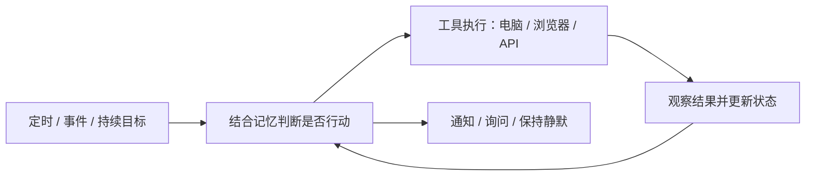

# awesome_bot

**主动式 Agent、个人 Bot、Harness 扩展与相关论文的中文精选目录。**

Curated proactive agents, personal bots, harness extensions, computer-use components, and research papers. Chinese-first, evidence-linked, with reproducible GitHub maintenance rankings.

这里关注的 Agent 会在用户没有发来新消息时，依据时间、环境变化、持续目标或记忆主动开始有用的工作，通过工具与数字环境交互，并在合适的时候向人反馈。能否保持静默、暂停或等待人的决定，也是主动性的一部分。

本清单同时收集完整产品、把现有 Agent 改造成主动助手的扩展，以及必要的执行组件。**定时执行、上下文主动判断、电脑操作是不同能力，不互相替代。**

[项目分类](#分类目录) · [论文](#论文) · [排序视图](docs/rankings.md) · [扩展路线](docs/harness-guide.md) · [检索过程](docs/research.md) · [贡献](CONTRIBUTING.md)



这是本目录采用的工作定义，不是对所有项目统一实现架构的断言。首版为精选起点，欢迎补充遗漏，不宣称穷尽所有项目。


## 当前快照

收录 **43 个项目 / 研究代码库、17 篇论文**。指标采集：**2026-11-06T03:31:11+00:00（UTC）**；功能人工核验：2026-11-06。

仅依据公开文档和 GitHub 元数据，尚未开展统一运行测评。类别与功能需人工复核，指标由脚本更新。


## 活跃主动项目速览

以下只从已核验开放许可证、主动机制已文档化、未归档项目中选取，按维护分排序；相邻组件、待核验许可和历史项目不进入此表。

| 项目 | 主动机制 | Stars | 90天提交 | 最近提交 UTC | 维护分 |
| --- | --- | --- | --- | --- | --- |
| [OpenClaw](https://github.com/openclaw/openclaw) | 定时 / heartbeat / 事件 | 393,998 | 48,930 | 2026-11-06 | 100.0 |
| [Hermes Agent](https://github.com/NousResearch/hermes-agent) | 定时 / 会话 heartbeat | 260,917 | 41,656 | 2026-11-06 | 100.0 |
| [nanobot](https://github.com/HKUDS/nanobot) | 定时 / 本地触发器 | 49,869 | 1,353 | 2026-11-06 | 97.6 |
| [ZeroClaw](https://github.com/zeroclaw-labs/zeroclaw) | cron / webhook / MQTT | 33,142 | 1,085 | 2026-11-06 | 96.1 |
| [NanoClaw](https://github.com/nanocoai/nanoclaw) | 定时 / script gates | 31,087 | 741 | 2026-11-05 | 95.8 |
| [Agent Zero](https://github.com/agent0ai/agent-zero) | scheduled operations | 19,756 | 540 | 2026-11-01 | 93.2 |
| [OpenMausBot](https://github.com/milind-soni/OpenMausBot) | schedules / webhooks / app events | 13,593 | 8,528 | 2026-11-06 | 93.0 |
| [OpenBot](https://github.com/CopilotKit/OpenBot) | 定时 routines / 人工发起 | 10,262 | 692 | 2026-11-06 | 92.1 |
| [Rakazo](https://github.com/elie222/rakazo) | routines | 7,212 | 3,009 | 2026-11-06 | 90.9 |
| [PilotDeck](https://github.com/OpenBMB/PilotDeck) | always-on 任务发现 | 4,981 | 968 | 2026-11-05 | 89.5 |


## 分类目录

`★种子` 为用户提供的参考项目。所有分类内部使用相同排序规则，归档项目自动后置。许可显示以人工核验与 GitHub SPDX 识别为依据；未知不会当成零或默认 MIT。


### 常驻个人助手与轻量运行时


| 项目 | 机制 / 定位 | Stars | 90天提交 | 最近提交 UTC | 维护分 | 许可 |
| --- | --- | --- | --- | --- | --- | --- |
| [OpenClaw](https://github.com/openclaw/openclaw) | 定时 / heartbeat / 事件 | 393,998 | 48,930 | 2026-11-06 | 100.0 | MIT |
| [Hermes Agent](https://github.com/NousResearch/hermes-agent) | 定时 / 会话 heartbeat | 260,917 | 41,656 | 2026-11-06 | 100.0 | MIT |
| [nanobot](https://github.com/HKUDS/nanobot) | 定时 / 本地触发器 | 49,869 | 1,353 | 2026-11-06 | 97.6 | MIT |
| [ZeroClaw](https://github.com/zeroclaw-labs/zeroclaw) | cron / webhook / MQTT | 33,142 | 1,085 | 2026-11-06 | 96.1 | Apache-2.0 |
| [NanoClaw](https://github.com/nanocoai/nanoclaw) | 定时 / script gates | 31,087 | 741 | 2026-11-05 | 95.8 | MIT |
| [OpenMausBot](https://github.com/milind-soni/OpenMausBot) | schedules / webhooks / app events | 13,593 | 8,528 | 2026-11-06 | 93.0 | Apache-2.0（enterprise/ 除外） |
| [Rakazo](https://github.com/elie222/rakazo) · ★种子 | routines | 7,212 | 3,009 | 2026-11-06 | 90.9 | Apache-2.0 |
| [nanoMuse](https://github.com/nano-muse/nanoMuse) · ★种子 | 目标巡检 / routines | 3,229 | 2,474 | 2026-11-05 | 87.8 | GPL-3.0 |
| [Moltis](https://github.com/moltis-org/moltis) | cron | 2,941 | 157 | 2026-10-23 | 77.8 | MIT |
| [IronClaw](https://github.com/nearai/ironclaw) | 定时 / 事件 / heartbeat | 12,713 | 261 | 2026-09-10 | 77.5 | Apache-2.0 |
| [Comma](https://github.com/AFK-surf/Comma) | routines / event loops | 475 | 8 | 2026-10-27 | 56.2 | AGPL-3.0 |
| [PicoClaw](https://github.com/sipeed/picoclaw) | 定时 | 30,103 | 1 | 2026-08-19 | 50.1 | MIT |
| [Mame](https://github.com/maikunari/mame) · 许可限制/待核验 | cron / heartbeat | 0 | 28 | 2026-08-21 | 29.6 | README 声明 MIT |
| [Khoj](https://github.com/khoj-ai/khoj) | scheduled automations | 38,013 | 0 | 2026-08-02 | 45.2 | AGPL-3.0 |
| [rho](https://github.com/mikeyobrien/rho) | heartbeat | 376 | 0 | 2026-05-26 | 24.7 | MIT |


### 工作空间与上下文助手


| 项目 | 机制 / 定位 | Stars | 90天提交 | 最近提交 UTC | 维护分 | 许可 |
| --- | --- | --- | --- | --- | --- | --- |
| [Agent Zero](https://github.com/agent0ai/agent-zero) | scheduled operations | 19,756 | 540 | 2026-11-01 | 93.2 | MIT |
| [OpenBot](https://github.com/CopilotKit/OpenBot) | 定时 routines / 人工发起 | 10,262 | 692 | 2026-11-06 | 92.1 | MIT |
| [PilotDeck](https://github.com/OpenBMB/PilotDeck) · ★种子 | always-on 任务发现 | 4,981 | 968 | 2026-11-05 | 89.5 | AGPL-3.0 |
| [OpenMuse](https://github.com/CopilotKit/openmuse) | 后台任务 worker；自主触发待核验 | 6,236 | 144 | 2026-10-26 | 80.6 | MIT |
| [OpenDuet](https://github.com/CopilotKit/OpenDuet) | routines / 后台建议 | 1,963 | 75 | 2026-10-31 | 74.3 | MIT |
| [MineContext](https://github.com/volcengine/MineContext) | 上下文观察 / 主动推送 | 5,543 | 0 | 2026-05-07 | 33.2 | Apache-2.0 |


### 主动插件与调度扩展


| 项目 | 机制 / 定位 | Stars | 90天提交 | 最近提交 UTC | 维护分 | 许可 |
| --- | --- | --- | --- | --- | --- | --- |
| [DS Bot](https://github.com/Fei2411/DS-Bot) · ★种子 | 持久 Bot / 群聊；自主唤醒待核验 | 5,747 | 1,576 | 2026-11-03 | 89.4 | Apache-2.0 |
| [dsh-proactive](https://github.com/john-walks-slow/dsh-proactive) | host 级 once / interval / cron | 13 | 97 | 2026-10-26 | 57.1 | MIT |
| [murmur](https://github.com/t0dorakis/murmur) | cron / interval | 32 | 0 | 2026-02-10 | 13.4 | MIT |
| [Pulse](https://github.com/Hypostas/pulse) | 传感 / 紧急度触发 | 4 | 0 | 2026-07-06 | 12.0 | MIT |
| [Hermes Bot Mode](https://github.com/NousResearch/Hermes-Bot-Mode) · 归档 | 宿主 cron routines | 670 | 114 | 2026-08-17 | 59.5 | MIT |


### 可扩展 Harness 与持久运行基础


| 项目 | 机制 / 定位 | Stars | 90天提交 | 最近提交 UTC | 维护分 | 许可 |
| --- | --- | --- | --- | --- | --- | --- |
| [Pi](https://github.com/earendil-works/pi) | 需上层调度 / 扩展 | 120,336 | 2,000 | 2026-11-05 | 100.0 | MIT |
| [DeepSeek Harness](https://github.com/deepseek-ai/deepseek-harness) | 需宿主插件提供主动机制 | 273,975 | 15,441 | 2026-11-04 | 99.5 | MIT |
| [Letta Code](https://github.com/letta-ai/letta-code) | remote environments / cron | 3,787 | 994 | 2026-11-06 | 88.6 | Apache-2.0 |


### 电脑与浏览器控制组件


| 项目 | 机制 / 定位 | Stars | 90天提交 | 最近提交 UTC | 维护分 | 许可 |
| --- | --- | --- | --- | --- | --- | --- |
| [Browser Use](https://github.com/browser-use/browser-use) | 按需浏览器任务 | 120,151 | 407 | 2026-10-30 | 97.0 | MIT |
| [Windows-MCP](https://github.com/CursorTouch/Windows-MCP) · ★种子 | 由宿主调用 | 11,150 | 118 | 2026-11-06 | 84.3 | MIT |
| [UI-TARS Desktop / Agent TARS](https://github.com/bytedance/UI-TARS-desktop) | 按需电脑 / 浏览器任务 | 39,554 | 8 | 2026-10-09 | 67.5 | Apache-2.0 |
| [Page Agent](https://github.com/alibaba/page-agent) | 由网页或宿主调用 | 29,642 | 20 | 2026-09-06 | 65.6 | MIT |


### 研究实现与评测代码


| 项目 | 机制 / 定位 | Stars | 90天提交 | 最近提交 UTC | 维护分 | 许可 |
| --- | --- | --- | --- | --- | --- | --- |
| [OSWorld](https://github.com/xlang-ai/OSWorld) | 真实电脑任务评测 | 3,251 | 190 | 2026-11-02 | 81.7 | Apache-2.0 |
| [MemoProAgent](https://github.com/facebookresearch/Memo-Pro-Agent) · 许可限制/待核验 | 记忆驱动介入评测 | 11 | 6 | 2026-10-22 | 40.7 | CC-BY-NC-4.0 |
| [π-Bench](https://github.com/Simplified-Reasoning/Pi-Bench) | 主动性评测 | 76 | 1 | 2026-10-13 | 38.2 | Apache-2.0 |
| [ProactiveAgent](https://github.com/thunlp/ProactiveAgent) | 事件观察 / 任务预判 | 688 | 0 | 2026-05-12 | 26.2 | Apache-2.0 |
| [PASK](https://github.com/xzf-thu/Pask) | 潜在需求检测 / 保持静默 | 219 | 0 | 2026-04-17 | 21.4 | Apache-2.0 |
| [KnowU-Bench](https://github.com/ZJU-REAL/KnowU-Bench) | 交互式个性化移动评测 | 82 | 0 | 2026-06-13 | 20.3 | Apache-2.0 |
| [ProactiveBench (MLLM)](https://github.com/tdemin16/proactivebench) | 多模态主动性评测 | 32 | 0 | 2026-06-22 | 17.6 | MIT |
| [PARE](https://github.com/deepakn97/pare) | 主动助手 / 用户模拟评测 | 46 | 0 | 2026-05-20 | 17.2 | MIT |
| [ContextAgent](https://github.com/openaiotlab/ContextAgent) · 许可限制/待核验 | 感知上下文 / 服务预测 | 58 | 0 | 2025-12-07 | 14.8 | 待核验 |


### 历史与迁移项目


| 项目 | 机制 / 定位 | Stars | 90天提交 | 最近提交 UTC | 维护分 | 许可 |
| --- | --- | --- | --- | --- | --- | --- |
| [LettaBot](https://github.com/letta-ai/lettabot) · 归档 | heartbeat / cron | 325 | 0 | 2026-05-03 | 23.3 | Apache-2.0 |


完整描述、边界与证据见 [项目详表](docs/projects.md)。按 star、活跃度、最新提交分别查看 [排序表](docs/rankings.md)。

## 论文

论文按问题分类，同类按首次提交日期倒序。论文年份、项目 star 与系统能力不是同一种评价，不混合计算。


### 定义、机制与基础研究

| 首次提交 | 论文 | 关注问题 |
| --- | --- | --- |
| 2026-09-29 | [Foundations of Proactive Agents: Principles, Technical Layers, and Proactivity-Gym](https://arxiv.org/abs/2609.37267) | 讨论主动 Agent 的技术层次与用户成本，并提出 Proactivity-Gym。 |
| 2025-05-20 | [ContextAgent: Context-Aware Proactive LLM Agents with Open-World Sensory Perceptions](https://arxiv.org/abs/2505.14668) | 利用可穿戴设备的感知上下文与历史画像，预测何时提供服务及调用工具。 |
| 2024-10-16 | [Proactive Agent: Shifting LLM Agents from Reactive Responses to Active Assistance](https://arxiv.org/abs/2410.12361) | 从桌面事件预判用户任务，并研究无需明确指令的主动辅助。 |
| 2023-04-07 | [Generative Agents: Interactive Simulacra of Human Behavior](https://arxiv.org/abs/2304.03442) | 研究用记忆、反思与规划构建能自主生活互动的模拟 Agent。 |


### 个人 Agent 系统

| 首次提交 | 论文 | 关注问题 |
| --- | --- | --- |
| 2026-10-06 | [nanoMuse: An Open-Source Personal Agent for Every Device You Own](https://arxiv.org/abs/2610.08699) | 介绍跨设备个人 Agent 的软件架构、记忆与持续交互设计。 |


### 长期记忆与潜在需求

| 首次提交 | 论文 | 关注问题 |
| --- | --- | --- |
| 2026-10-15 | [MemoProAgent: Toward Memory-Driven Proactive Assistance](https://arxiv.org/abs/2610.22671) | 研究从长期个人记忆中检索介入证据，让记忆参与是否发言的判断。 |
| 2026-04-09 | [PASK: Toward Intent-Aware Proactive Agents with Long-Term Memory](https://arxiv.org/abs/2604.08000) | 结合长期记忆、实时上下文与延迟约束，检测潜在需求并选择协助或静默。 |


### 主动性评测基准

| 首次提交 | 论文 | 关注问题 |
| --- | --- | --- |
| 2026-05-14 | [π-Bench: Evaluating Proactive Personal Assistant Agents in Long-Horizon Workflows](https://arxiv.org/abs/2605.14678) | 在多轮长期工作流中评测隐藏需求识别和主动协助。 |
| 2026-04-09 | [KnowU-Bench: Towards Interactive, Proactive, and Personalized Mobile Agent Evaluation](https://arxiv.org/abs/2604.08455) | 评测移动 Agent 交互获取偏好、主动介入、征求同意或保持静默。 |
| 2026-04-01 | [Proactive Agent Research Environment: Simulating Active Users to Evaluate Proactive Assistants](https://arxiv.org/abs/2604.00842) | 用有状态的应用与活跃用户模拟环境研究主动助手。 |
| 2026-03-19 | [ProactiveBench: Benchmarking Proactiveness in Multimodal Large Language Models](https://arxiv.org/abs/2603.19466) | 评测多模态模型主动获取额外信息以完成视觉任务的能力。 |
| 2026-03-09 | [PIRA-Bench: A Transition from Reactive GUI Agents to GUI-based Proactive Intent Recommendation Agents](https://arxiv.org/abs/2603.08013) | 根据连续 GUI 截图和用户上下文推荐潜在意图。 |
| 2026-02-04 | [ProAgentBench: Evaluating LLM Agents for Proactive Assistance with Real-World Data](https://arxiv.org/abs/2602.04482) | 使用真实工作流日志评测主动辅助的时机与内容。 |


### 电脑操作与个性化执行

| 首次提交 | 论文 | 关注问题 |
| --- | --- | --- |
| 2026-06-15 | [MyPCBench: A Benchmark for Personally Intelligent Computer-Use Agents](https://arxiv.org/abs/2606.16748) | 在有个人数据与登录状态的数字环境中评测电脑操作助手。 |
| 2024-04-11 | [OSWorld: Benchmarking Multimodal Agents for Open-Ended Tasks in Real Computer Environments](https://arxiv.org/abs/2404.07972) | 提供真实电脑环境中的开放任务执行基准。 |


### 长期运行与可靠性研究

| 首次提交 | 论文 | 关注问题 |
| --- | --- | --- |
| 2026-05-13 | [Sleeper Channels and Provenance Gates: Persistent Prompt Injection in Always-on Autonomous AI Agents](https://arxiv.org/abs/2605.13471) | 分析跨记忆、技能、调度和文件系统持久化的间接提示注入路径。 |
| 2026-03-24 | [Mind Your HEARTBEAT! Claw Background Execution Inherently Enables Silent Memory Pollution](https://arxiv.org/abs/2603.23064) | 研究后台 heartbeat 接触不可信内容后造成的静默记忆污染。 |


论文版本、代码关联与适用边界见 [论文详表](docs/papers.md)。

## 维护与贡献

- [定义、纳入标准与分类](docs/taxonomy.md)
- [排序公式与局限](docs/methodology.md)
- [检索词、来源与调研覆盖](docs/research.md)
- [基于现有 Harness 的扩展路线](docs/harness-guide.md)
- [贡献方式](CONTRIBUTING.md)

```sh
python scripts/refresh_metrics.py   # 需要 gh 登录或 GH_TOKEN
python scripts/build.py
python -m unittest discover -s tests
python scripts/build.py --check
```

GitHub Actions 每天更新已收录项目的指标与排序。新增项目、论文和功能分类通过人工核验后合并；自动指标更新不代表功能或许可已重新审计。

## 致谢与许可

检索入口参考 [Awesome Proactive Agents](https://github.com/LowEntropyAI/awesome-proactive-agent) 和 [Awesome Personal Agents](https://github.com/upgundecha/awesome-personal-agents)，条目回到原始仓库及论文核验。

本仓库原创说明、整理数据及维护脚本使用 [MIT](LICENSE)。所链接项目、论文、模型和数据遵循各自许可。
