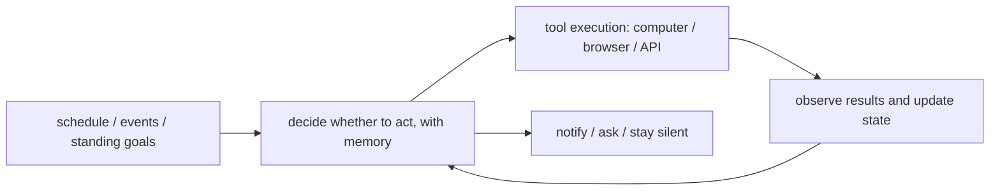

🌐 **English** · [简体中文](locales/zh/README.md) · [Español](locales/es/README.md) · [हिन्दी](locales/hi/README.md) · [Français](locales/fr/README.md)

# awesome_bot

**A curated directory of proactive agents, personal bots, harness extensions and related papers.**

Curated proactive agents, personal bots, harness extensions, computer-use components, and research papers — evidence-linked, with reproducible GitHub maintenance rankings.

The agents covered here start useful work on their own — driven by time, environment changes, standing goals or memory — even when the user has sent no new message; they interact with the digital environment through tools and report back at the right moment. Knowing when to stay silent, pause or wait for a human decision is also part of proactivity.

This list collects complete products, extensions that turn existing agents into proactive assistants, and the execution components they need. **Scheduled execution, contextual proactive judgement and computer use are different capabilities and do not substitute for each other.**

[Categories](#categories) · [Papers](#papers) · [Rankings](docs/rankings.md) · [Extension paths](docs/harness-guide.md) · [Search process](docs/research.md) · [Contributing](CONTRIBUTING.md)



This is the working definition adopted by the directory, not an assertion that all projects share one implementation architecture. The first release is a curated starting point; additions for anything missed are welcome, and no claim of exhaustiveness is made.


## Jump to a category

[Resident personal assistants and lightweight runtimes](#resident-personal-assistants-and-lightweight-runtimes) · [Workspace and context assistants](#workspace-and-context-assistants) · [Proactive plugins and scheduling extensions](#proactive-plugins-and-scheduling-extensions) · [Extensible harnesses and persistent runtime bases](#extensible-harnesses-and-persistent-runtime-bases) · [Computer and browser control components](#computer-and-browser-control-components) · [Research implementations and evaluation code](#research-implementations-and-evaluation-code) · [Historical and migration projects](#historical-and-migration-projects)

**Papers** · [Definitions, mechanisms and foundational research](#definitions-mechanisms-and-foundational-research) · [Personal agent systems](#personal-agent-systems) · [Long-term memory and latent needs](#long-term-memory-and-latent-needs) · [Proactivity evaluation benchmarks](#proactivity-evaluation-benchmarks) · [Computer use and personalized execution](#computer-use-and-personalized-execution) · [Long-running operation and reliability research](#long-running-operation-and-reliability-research)


## Current snapshot

Catalogue of **44 projects / research code repositories and 17 papers**. Metrics collected: **2026-11-25T11:19:55+00:00 (UTC)**; features manually verified: 2026-11-11.

Based only on public documentation and GitHub metadata; no unified hands-on evaluation has been run. Categories and features require manual review, and metrics are refreshed by scripts.


## Active proactive projects at a glance

Selected only from projects with a verified open license, a documented proactive mechanism and no archival flag, ordered by maintenance score; adjacent components, pending-license projects and historical projects do not enter this table.

| Project | Proactive mechanism | Stars | 90-day commits | Last commit UTC | Maintenance score |
| --- | --- | --- | --- | --- | --- |
| [OpenClaw](https://github.com/openclaw/openclaw) | scheduled / heartbeat / events | 395,178 | 48,666 | 2026-11-25 | 100.0 |
| [Hermes Agent](https://github.com/NousResearch/hermes-agent) | scheduled / session heartbeat | 266,002 | 50,705 | 2026-11-25 | 100.0 |
| [nanobot](https://github.com/HKUDS/nanobot) | scheduled / local triggers | 50,314 | 1,226 | 2026-11-25 | 97.6 |
| [ZeroClaw](https://github.com/zeroclaw-labs/zeroclaw) | cron / webhook / MQTT | 33,609 | 1,063 | 2026-11-25 | 96.2 |
| [NanoClaw](https://github.com/nanocoai/nanoclaw) | scheduled / script gates | 31,159 | 531 | 2026-11-24 | 95.8 |
| [OpenMausBot](https://github.com/milind-soni/OpenMausBot) | schedules / webhooks / app events | 27,710 | 12,676 | 2026-11-25 | 95.5 |
| [OpenBot](https://github.com/CopilotKit/OpenBot) | scheduled routines / user-initiated | 13,473 | 1,428 | 2026-11-25 | 93.0 |
| [Agent Zero](https://github.com/agent0ai/agent-zero) | scheduled operations | 19,980 | 444 | 2026-11-20 | 92.5 |
| [Rakazo](https://github.com/elie222/rakazo) | routines | 9,744 | 4,669 | 2026-11-25 | 91.9 |
| [Suparagent](https://github.com/Anil-matcha/suparagent) | scheduled / webhook / manual routines | 7,170 | 789 | 2026-11-25 | 90.8 |


## Categories

`★Seed` marks reference projects provided by the user. Every category uses the same ordering rules, and archived projects are automatically pushed to the end. License display follows manual verification and GitHub SPDX identification; an unknown license is never treated as zero or defaulted to MIT.


### Resident personal assistants and lightweight runtimes


| Project | Mechanism / positioning | Stars | 90-day commits | Last commit UTC | Maintenance score | License |
| --- | --- | --- | --- | --- | --- | --- |
| [OpenClaw](https://github.com/openclaw/openclaw) | scheduled / heartbeat / events | 395,178 | 48,666 | 2026-11-25 | 100.0 | MIT |
| [Hermes Agent](https://github.com/NousResearch/hermes-agent) | scheduled / session heartbeat | 266,002 | 50,705 | 2026-11-25 | 100.0 | MIT |
| [nanobot](https://github.com/HKUDS/nanobot) | scheduled / local triggers | 50,314 | 1,226 | 2026-11-25 | 97.6 | MIT |
| [ZeroClaw](https://github.com/zeroclaw-labs/zeroclaw) | cron / webhook / MQTT | 33,609 | 1,063 | 2026-11-25 | 96.2 | Apache-2.0 |
| [NanoClaw](https://github.com/nanocoai/nanoclaw) | scheduled / script gates | 31,159 | 531 | 2026-11-24 | 95.8 | MIT |
| [OpenMausBot](https://github.com/milind-soni/OpenMausBot) | schedules / webhooks / app events | 27,710 | 12,676 | 2026-11-25 | 95.5 | Apache-2.0 (except enterprise/) |
| [Rakazo](https://github.com/elie222/rakazo) · ★Seed | routines | 9,744 | 4,669 | 2026-11-25 | 91.9 | Apache-2.0 |
| [nanoMuse](https://github.com/nano-muse/nanoMuse) · ★Seed | goal checks / routines | 3,702 | 2,765 | 2026-11-25 | 88.5 | GPL-3.0 |
| [Moltis](https://github.com/moltis-org/moltis) | cron | 2,988 | 51 | 2026-10-23 | 67.4 | MIT |
| [IronClaw](https://github.com/nearai/ironclaw) | scheduled / events / heartbeat | 12,721 | 57 | 2026-09-10 | 66.5 | Apache-2.0 |
| [Comma](https://github.com/AFK-surf/Comma) | routines / event loops | 637 | 10 | 2026-11-17 | 58.9 | AGPL-3.0 |
| [PicoClaw](https://github.com/sipeed/picoclaw) | scheduled | 30,160 | 0 | 2026-08-19 | 44.2 | MIT |
| [Khoj](https://github.com/khoj-ai/khoj) | scheduled automations | 38,238 | 0 | 2026-08-02 | 43.6 | AGPL-3.0 |
| [rho](https://github.com/mikeyobrien/rho) | heartbeat | 379 | 0 | 2026-05-26 | 23.9 | MIT |
| [Mame](https://github.com/maikunari/mame) · License caution/pending | cron / heartbeat | 0 | 0 | 2026-08-21 | 8.6 | README declares MIT |


### Workspace and context assistants


| Project | Mechanism / positioning | Stars | 90-day commits | Last commit UTC | Maintenance score | License |
| --- | --- | --- | --- | --- | --- | --- |
| [OpenBot](https://github.com/CopilotKit/OpenBot) | scheduled routines / user-initiated | 13,473 | 1,428 | 2026-11-25 | 93.0 | MIT |
| [Agent Zero](https://github.com/agent0ai/agent-zero) | scheduled operations | 19,980 | 444 | 2026-11-20 | 92.5 | MIT |
| [Suparagent](https://github.com/Anil-matcha/suparagent) | scheduled / webhook / manual routines | 7,170 | 789 | 2026-11-25 | 90.8 | Apache-2.0 |
| [PilotDeck](https://github.com/OpenBMB/PilotDeck) · ★Seed | always-on task discovery | 5,030 | 956 | 2026-11-24 | 89.3 | AGPL-3.0 |
| [OpenFuse](https://github.com/CopilotKit/openfuse) | background task worker; autonomous triggering unverified | 6,586 | 146 | 2026-11-17 | 81.6 | MIT |
| [OpenDuet](https://github.com/CopilotKit/OpenDuet) | routines / background suggestions | 2,150 | 92 | 2026-11-24 | 76.9 | MIT |
| [MineContext](https://github.com/volcengine/MineContext) | context observation / proactive push | 5,556 | 0 | 2026-05-07 | 32.6 | Apache-2.0 |


### Proactive plugins and scheduling extensions


| Project | Mechanism / positioning | Stars | 90-day commits | Last commit UTC | Maintenance score | License |
| --- | --- | --- | --- | --- | --- | --- |
| [DS Bot](https://github.com/Fei-Craft/DS-Bot) · ★Seed | persistent bot / group chat; autonomous wake-up unverified | 8,913 | 3,858 | 2026-11-22 | 90.8 | Apache-2.0 |
| [dsh-proactive](https://github.com/john-walks-slow/dsh-proactive) | host-level once / interval / cron | 17 | 97 | 2026-10-26 | 53.7 | MIT |
| [murmur](https://github.com/t0dorakis/murmur) | cron / interval | 32 | 0 | 2026-02-10 | 13.2 | MIT |
| [Pulse](https://github.com/Hypostas/pulse) | sensing / urgency-triggered | 4 | 0 | 2026-07-06 | 10.8 | MIT |
| [Hermes Bot Mode](https://github.com/NousResearch/Hermes-Bot-Mode) · Archived | host cron routines | 674 | 0 | 2026-08-17 | 30.8 | MIT |


### Extensible harnesses and persistent runtime bases


| Project | Mechanism / positioning | Stars | 90-day commits | Last commit UTC | Maintenance score | License |
| --- | --- | --- | --- | --- | --- | --- |
| [Pi](https://github.com/earendil-works/pi) | needs upstream scheduling / extensions | 123,801 | 2,091 | 2026-11-25 | 100.0 | MIT |
| [DeepSeek Harness](https://github.com/deepseek-ai/deepseek-harness) | needs host plugins to provide the proactive mechanism | 286,833 | 14,571 | 2026-11-22 | 99.2 | MIT |
| [Letta Code](https://github.com/letta-ai/letta-code) | remote environments / cron | 3,914 | 978 | 2026-11-24 | 88.6 | Apache-2.0 |


### Computer and browser control components


| Project | Mechanism / positioning | Stars | 90-day commits | Last commit UTC | Maintenance score | License |
| --- | --- | --- | --- | --- | --- | --- |
| [Browser Use](https://github.com/browser-use/browser-use) | on-demand browser tasks | 122,001 | 979 | 2026-11-24 | 99.9 | MIT |
| [Windows-MCP](https://github.com/CursorTouch/Windows-MCP) · ★Seed | invoked by the host | 12,130 | 177 | 2026-11-25 | 86.8 | MIT |
| [Page Agent](https://github.com/alibaba/page-agent) | invoked by the page or host | 29,755 | 40 | 2026-11-18 | 79.8 | MIT |
| [UI-TARS Desktop / Agent TARS](https://github.com/bytedance/UI-TARS-desktop) · Archived | on-demand computer / browser tasks | 39,589 | 8 | 2026-10-09 | 63.9 | Apache-2.0 |


### Research implementations and evaluation code


| Project | Mechanism / positioning | Stars | 90-day commits | Last commit UTC | Maintenance score | License |
| --- | --- | --- | --- | --- | --- | --- |
| [OSWorld](https://github.com/xlang-ai/OSWorld) | real-computer task evaluation | 3,278 | 213 | 2026-11-23 | 82.7 | Apache-2.0 |
| [KnowU-Bench](https://github.com/ZJU-REAL/KnowU-Bench) | interactive personalized mobile evaluation | 83 | 1 | 2026-11-13 | 41.3 | Apache-2.0 |
| [MemoProAgent](https://github.com/facebookresearch/Memo-Pro-Agent) · License caution/pending | memory-driven intervention evaluation | 16 | 6 | 2026-10-22 | 37.9 | CC-BY-NC-4.0 |
| [π-Bench](https://github.com/Simplified-Reasoning/Pi-Bench) | proactivity evaluation | 78 | 1 | 2026-10-13 | 34.6 | Apache-2.0 |
| [ProactiveAgent](https://github.com/thunlp/ProactiveAgent) | event observation / task prediction | 697 | 0 | 2026-05-12 | 25.6 | Apache-2.0 |
| [PASK](https://github.com/xzf-thu/Pask) | latent need detection / staying silent | 219 | 0 | 2026-04-17 | 20.9 | Apache-2.0 |
| [PARE](https://github.com/deepakn97/pare) | proactive assistant / user-simulation evaluation | 50 | 0 | 2026-05-20 | 16.7 | MIT |
| [ProactiveBench (MLLM)](https://github.com/tdemin16/proactivebench) | multimodal proactivity evaluation | 32 | 0 | 2026-06-22 | 16.6 | MIT |
| [ContextAgent](https://github.com/openaiotlab/ContextAgent) · License caution/pending | sensory context / service prediction | 59 | 0 | 2025-12-07 | 14.7 | Pending verification |


### Historical and migration projects


| Project | Mechanism / positioning | Stars | 90-day commits | Last commit UTC | Maintenance score | License |
| --- | --- | --- | --- | --- | --- | --- |
| [LettaBot](https://github.com/letta-ai/lettabot) · Archived | heartbeat / cron | 328 | 0 | 2026-05-03 | 22.7 | Apache-2.0 |


Full descriptions, boundaries and evidence are in [project details](docs/projects.md). For separate star, activity and latest-commit views see the [ranking tables](docs/rankings.md).

## Papers

Papers are grouped by research question; within a group, entries are sorted by first-submission date, newest first. Paper years, project stars and system capability are different kinds of assessment and are never mixed into one score.


### Definitions, mechanisms and foundational research

| First submitted | Paper | Research question |
| --- | --- | --- |
| 2026-09-29 | [Foundations of Proactive Agents: Principles, Technical Layers, and Proactivity-Gym](https://arxiv.org/abs/2609.37267) | Discusses the technical layers and user costs of proactive agents and introduces Proactivity-Gym. |
| 2025-05-20 | [ContextAgent: Context-Aware Proactive LLM Agents with Open-World Sensory Perceptions](https://arxiv.org/abs/2505.14668) | Uses sensory context from wearable devices and historical user profiles to predict when to provide a service and invoke tools. |
| 2024-10-16 | [Proactive Agent: Shifting LLM Agents from Reactive Responses to Active Assistance](https://arxiv.org/abs/2410.12361) | Predicts user tasks from desktop events and studies proactive assistance without explicit instructions. |
| 2023-04-07 | [Generative Agents: Interactive Simulacra of Human Behavior](https://arxiv.org/abs/2304.03442) | Studies building simulated agents that live and interact autonomously through memory, reflection and planning. |


### Personal agent systems

| First submitted | Paper | Research question |
| --- | --- | --- |
| 2026-10-06 | [nanoMuse: An Open-Source Personal Agent for Every Device You Own](https://arxiv.org/abs/2610.08699) | Presents the software architecture, memory design and continuous-interaction design of a cross-device personal agent. |


### Long-term memory and latent needs

| First submitted | Paper | Research question |
| --- | --- | --- |
| 2026-10-15 | [MemoProAgent: Toward Memory-Driven Proactive Assistance](https://arxiv.org/abs/2610.22671) | Studies retrieving intervention evidence from long-term personal memory so that memory participates in the decision of whether to speak up. |
| 2026-04-09 | [PASK: Toward Intent-Aware Proactive Agents with Long-Term Memory](https://arxiv.org/abs/2604.08000) | Combines long-term memory, live context and latency constraints to detect latent needs and choose between assisting and staying silent. |


### Proactivity evaluation benchmarks

| First submitted | Paper | Research question |
| --- | --- | --- |
| 2026-05-14 | [π-Bench: Evaluating Proactive Personal Assistant Agents in Long-Horizon Workflows](https://arxiv.org/abs/2605.14678) | Evaluates hidden-need recognition and proactive assistance across long multi-turn workflows. |
| 2026-04-09 | [KnowU-Bench: Towards Interactive, Proactive, and Personalized Mobile Agent Evaluation](https://arxiv.org/abs/2604.08455) | Evaluates mobile agents on interactively eliciting preferences, intervening proactively, asking for consent, or staying silent. |
| 2026-04-01 | [Proactive Agent Research Environment: Simulating Active Users to Evaluate Proactive Assistants](https://arxiv.org/abs/2604.00842) | Studies proactive assistants in a simulated environment with stateful apps and active users. |
| 2026-03-19 | [ProactiveBench: Benchmarking Proactiveness in Multimodal Large Language Models](https://arxiv.org/abs/2603.19466) | Evaluates whether multimodal models proactively gather extra information to complete visual tasks. |
| 2026-03-09 | [PIRA-Bench: A Transition from Reactive GUI Agents to GUI-based Proactive Intent Recommendation Agents](https://arxiv.org/abs/2603.08013) | Recommends likely intents from continuous GUI screenshots and user context. |
| 2026-02-04 | [ProAgentBench: Evaluating LLM Agents for Proactive Assistance with Real-World Data](https://arxiv.org/abs/2602.04482) | Evaluates the timing and content of proactive assistance using real workflow logs. |


### Computer use and personalized execution

| First submitted | Paper | Research question |
| --- | --- | --- |
| 2026-06-15 | [MyPCBench: A Benchmark for Personally Intelligent Computer-Use Agents](https://arxiv.org/abs/2606.16748) | Evaluates computer-use assistants in digital environments holding personal data and logged-in state. |
| 2024-04-11 | [OSWorld: Benchmarking Multimodal Agents for Open-Ended Tasks in Real Computer Environments](https://arxiv.org/abs/2404.07972) | Provides an open-ended task-execution benchmark in real computer environments. |


### Long-running operation and reliability research

| First submitted | Paper | Research question |
| --- | --- | --- |
| 2026-05-13 | [Sleeper Channels and Provenance Gates: Persistent Prompt Injection in Always-on Autonomous AI Agents](https://arxiv.org/abs/2605.13471) | Analyzes indirect prompt-injection paths that persist across memory, skills, scheduling and the file system. |
| 2026-03-24 | [Mind Your HEARTBEAT! Claw Background Execution Inherently Enables Silent Memory Pollution](https://arxiv.org/abs/2603.23064) | Studies silent memory pollution caused by background heartbeat runs touching untrusted content. |


Paper versions, code links and applicability boundaries are in [paper details](docs/papers.md).

## Maintenance and contributing

- [Definitions, inclusion criteria and categories](docs/taxonomy.md)
- [Ranking formula and its limits](docs/methodology.md)
- [Search terms, sources and research coverage](docs/research.md)
- [Extension paths on existing harnesses](docs/harness-guide.md)
- [Contributing](CONTRIBUTING.md)

```sh
python scripts/refresh_metrics.py   # requires a logged-in gh or GH_TOKEN
python scripts/build.py
python -m unittest discover -s tests
python scripts/build.py --check
```

GitHub Actions refreshes metrics and rankings for listed projects every day. New projects, papers and feature classifications merge only after manual verification; an automated metrics refresh does not mean features or licenses were re-audited.

## Acknowledgements and licenses

Discovery entry points referenced [Awesome Proactive Agents](https://github.com/LowEntropyAI/awesome-proactive-agent) and [Awesome Personal Agents](https://github.com/upgundecha/awesome-personal-agents); every item was verified back at its original repository and paper.

Original explanations, curated data and maintenance scripts in this repository use the [MIT](LICENSE) license. Linked projects, papers, models and data follow their own licenses.

The [change records](record/) preserve the original text (in Chinese) from the time of each verification, so the source and the wording behind every judgement stay auditable.
