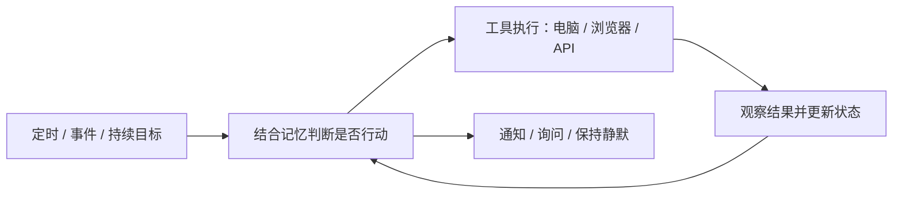

# awesome_bot

**主动式 Agent、个人 Bot、Harness 扩展与相关论文的中文精选目录。**

Curated proactive agents, personal bots, harness extensions, computer-use components, and research papers. Chinese-first, evidence-linked, with reproducible GitHub maintenance rankings.

这里关注的 Agent 会在用户没有发来新消息时，依据时间、环境变化、持续目标或记忆主动开始有用的工作，通过工具与数字环境交互，并在合适的时候向人反馈。能否保持静默、暂停或等待人的决定，也是主动性的一部分。

本清单同时收集完整产品、把现有 Agent 改造成主动助手的扩展，以及必要的执行组件。**定时执行、上下文主动判断、电脑操作是不同能力，不互相替代。**

[项目分类](#分类目录) · [论文](#论文) · [排序视图](docs/rankings.md) · [扩展路线](docs/harness-guide.md) · [检索过程](docs/research.md) · [贡献](CONTRIBUTING.md)

这是本目录采用的工作定义，不是对所有项目统一实现架构的断言。首版为精选起点，欢迎补充遗漏，不宣称穷尽所有项目。
