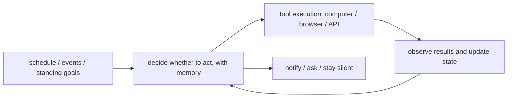

# awesome_bot

**A curated directory of proactive agents, personal bots, harness extensions and related papers.**

Curated proactive agents, personal bots, harness extensions, computer-use components, and research papers — evidence-linked, with reproducible GitHub maintenance rankings.

The agents covered here start useful work on their own — driven by time, environment changes, standing goals or memory — even when the user has sent no new message; they interact with the digital environment through tools and report back at the right moment. Knowing when to stay silent, pause or wait for a human decision is also part of proactivity.

This list collects complete products, extensions that turn existing agents into proactive assistants, and the execution components they need. **Scheduled execution, contextual proactive judgement and computer use are different capabilities and do not substitute for each other.**

[Categories](#categories) · [Papers](#papers) · [Rankings](docs/rankings.md) · [Extension paths](docs/harness-guide.md) · [Search process](docs/research.md) · [Contributing](CONTRIBUTING.md)

This is the working definition adopted by the directory, not an assertion that all projects share one implementation architecture. The first release is a curated starting point; additions for anything missed are welcome, and no claim of exhaustiveness is made.
