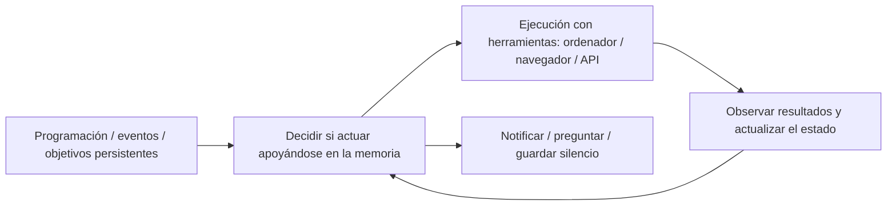

🌐 [English](../../README.md) · [简体中文](../zh/README.md) · **Español** · [हिन्दी](../hi/README.md) · [Français](../fr/README.md)

# awesome_bot

**Catálogo selecto de agentes proactivos, bots personales, extensiones de harness y artículos relacionados.**

Selección de agentes proactivos, bots personales, extensiones de harness, componentes de uso del ordenador y artículos de investigación, con la revisión canónica en chino, evidencia enlazada y clasificaciones reproducibles de mantenimiento en GitHub.

Los agentes que interesan aquí empiezan a trabajar de forma útil cuando el usuario no ha enviado ningún mensaje nuevo, guiándose por el tiempo, los cambios del entorno, objetivos persistentes o la memoria; interactúan con el entorno digital mediante herramientas y devuelven la información a la persona en el momento adecuado. La capacidad de callar, pausar o esperar una decisión humana también forma parte de la proactividad.

Esta lista recoge a la vez productos completos, extensiones que convierten agentes existentes en asistentes proactivos y los componentes de ejecución necesarios. **La ejecución programada, el juicio proactivo según contexto y el uso del ordenador son capacidades distintas que no se sustituyen entre sí.**

[Clasificación de proyectos](#categorías) · [Artículos](#artículos) · [Vistas de ordenación](docs/rankings.md) · [Rutas de extensión](docs/harness-guide.md) · [Proceso de búsqueda](docs/research.md) · [Contribuir](CONTRIBUTING.md)



Esta es la definición de trabajo que adopta el catálogo, no una afirmación de que todos los proyectos compartan una misma arquitectura. La primera versión es un punto de partida selectivo: se agradecen las omisiones que falten, pero no se declara exhaustivo el conjunto de proyectos.


## Ir a una categoría

[Asistentes personales siempre activos y runtime ligeros](#asistentes-personales-siempre-activos-y-runtime-ligeros) · [Asistentes de espacio de trabajo y contexto](#asistentes-de-espacio-de-trabajo-y-contexto) · [Complementos proactivos y extensiones de planificación](#complementos-proactivos-y-extensiones-de-planificación) · [Harness extensibles y base de ejecución persistente](#harness-extensibles-y-base-de-ejecución-persistente) · [Componentes de control de ordenador y navegador](#componentes-de-control-de-ordenador-y-navegador) · [Implementaciones de investigación y código de evaluación](#implementaciones-de-investigación-y-código-de-evaluación) · [Proyectos históricos y de migración](#proyectos-históricos-y-de-migración)

**Artículos** · [Definiciones, mecanismos e investigación fundamental](#definiciones-mecanismos-e-investigación-fundamental) · [Sistemas de agentes personales](#sistemas-de-agentes-personales) · [Memoria a largo plazo y necesidades latentes](#memoria-a-largo-plazo-y-necesidades-latentes) · [Benchmarks de proactividad](#benchmarks-de-proactividad) · [Uso del ordenador y ejecución personalizada](#uso-del-ordenador-y-ejecución-personalizada) · [Investigación sobre ejecución prolongada y fiabilidad](#investigación-sobre-ejecución-prolongada-y-fiabilidad)


## Instantánea actual

Catálogo con **44 proyectos o repositorios de investigación y 17 artículos**. Recolección de métricas: **2026-11-26T09:37:27+00:00 (UTC)**; verificación manual de funciones: 2026-11-11.

Solo se usan documentación pública y metadatos de GitHub; aún no se han realizado pruebas de ejecución uniformes. Las categorías y las funciones requieren revisión humana; las métricas las actualizan los scripts.


## Vistazo rápido a los proyectos proactivos activos

Aquí solo entran proyectos no archivados, con licencia abierta verificada y mecanismo proactivo documentado, ordenados por puntuación de mantenimiento; los componentes adyacentes, las licencias pendientes de verificación y los proyectos históricos no aparecen en esta tabla.

| Proyecto | Mecanismo proactivo | Estrellas | Commits 90 d | Último commit UTC | Puntuación de mantenimiento |
| --- | --- | --- | --- | --- | --- |
| [OpenClaw](https://github.com/openclaw/openclaw) | programación / heartbeat / eventos | 395,257 | 48,572 | 2026-11-26 | 100.0 |
| [Hermes Agent](https://github.com/NousResearch/hermes-agent) | programación / heartbeat de sesión | 266,213 | 50,744 | 2026-11-26 | 100.0 |
| [nanobot](https://github.com/HKUDS/nanobot) | programación / disparadores locales | 50,355 | 1,220 | 2026-11-26 | 97.5 |
| [ZeroClaw](https://github.com/zeroclaw-labs/zeroclaw) | cron / webhook / MQTT | 33,628 | 1,073 | 2026-11-26 | 96.2 |
| [OpenMausBot](https://github.com/milind-soni/OpenMausBot) | schedules / webhooks / app events | 27,967 | 12,973 | 2026-11-26 | 95.6 |
| [NanoClaw](https://github.com/nanocoai/nanoclaw) | programación / script gates | 31,167 | 525 | 2026-11-24 | 95.5 |
| [OpenBot](https://github.com/CopilotKit/OpenBot) | routines programadas / inicio manual | 13,565 | 1,449 | 2026-11-26 | 93.0 |
| [Agent Zero](https://github.com/agent0ai/agent-zero) | scheduled operations | 19,995 | 438 | 2026-11-20 | 92.1 |
| [Rakazo](https://github.com/elie222/rakazo) | routines | 9,823 | 4,666 | 2026-11-26 | 91.9 |
| [Suparagent](https://github.com/Anil-matcha/suparagent) | scheduled / webhook / manual routines | 7,172 | 817 | 2026-11-26 | 90.8 |


## Categorías

`★Semilla` marca los proyectos de referencia aportados por el usuario. Dentro de todas las categorías se aplica la misma regla de ordenación y los proyectos archivados van automáticamente al final. La licencia mostrada se basa en la verificación manual y en la identificación SPDX de GitHub; lo desconocido no se toma como cero ni como MIT por defecto.


### Asistentes personales siempre activos y runtime ligeros


| Proyecto | Mecanismo / propósito | Estrellas | Commits 90 d | Último commit UTC | Puntuación de mantenimiento | Licencia |
| --- | --- | --- | --- | --- | --- | --- |
| [OpenClaw](https://github.com/openclaw/openclaw) | programación / heartbeat / eventos | 395,257 | 48,572 | 2026-11-26 | 100.0 | MIT |
| [Hermes Agent](https://github.com/NousResearch/hermes-agent) | programación / heartbeat de sesión | 266,213 | 50,744 | 2026-11-26 | 100.0 | MIT |
| [nanobot](https://github.com/HKUDS/nanobot) | programación / disparadores locales | 50,355 | 1,220 | 2026-11-26 | 97.5 | MIT |
| [ZeroClaw](https://github.com/zeroclaw-labs/zeroclaw) | cron / webhook / MQTT | 33,628 | 1,073 | 2026-11-26 | 96.2 | Apache-2.0 |
| [OpenMausBot](https://github.com/milind-soni/OpenMausBot) | schedules / webhooks / app events | 27,967 | 12,973 | 2026-11-26 | 95.6 | Apache-2.0 (excepto enterprise/) |
| [NanoClaw](https://github.com/nanocoai/nanoclaw) | programación / script gates | 31,167 | 525 | 2026-11-24 | 95.5 | MIT |
| [Rakazo](https://github.com/elie222/rakazo) · ★Semilla | routines | 9,823 | 4,666 | 2026-11-26 | 91.9 | Apache-2.0 |
| [nanoMuse](https://github.com/nano-muse/nanoMuse) · ★Semilla | revisión de objetivos / routines | 3,720 | 2,767 | 2026-11-25 | 88.3 | GPL-3.0 |
| [Moltis](https://github.com/moltis-org/moltis) | cron | 2,988 | 49 | 2026-10-23 | 67.0 | MIT |
| [IronClaw](https://github.com/nearai/ironclaw) | programación / eventos / heartbeat | 12,720 | 44 | 2026-09-10 | 64.9 | Apache-2.0 |
| [Comma](https://github.com/AFK-surf/Comma) | routines / event loops | 652 | 10 | 2026-11-17 | 58.7 | AGPL-3.0 |
| [PicoClaw](https://github.com/sipeed/picoclaw) | programación | 30,170 | 0 | 2026-08-19 | 44.2 | MIT |
| [Khoj](https://github.com/khoj-ai/khoj) | scheduled automations | 38,258 | 0 | 2026-08-02 | 43.5 | AGPL-3.0 |
| [rho](https://github.com/mikeyobrien/rho) | heartbeat | 378 | 0 | 2026-05-26 | 23.9 | MIT |
| [Mame](https://github.com/maikunari/mame) · Licencia restringida/pendiente | cron / heartbeat | 0 | 0 | 2026-08-21 | 8.5 | MIT declarada en el README |


### Asistentes de espacio de trabajo y contexto


| Proyecto | Mecanismo / propósito | Estrellas | Commits 90 d | Último commit UTC | Puntuación de mantenimiento | Licencia |
| --- | --- | --- | --- | --- | --- | --- |
| [OpenBot](https://github.com/CopilotKit/OpenBot) | routines programadas / inicio manual | 13,565 | 1,449 | 2026-11-26 | 93.0 | MIT |
| [Agent Zero](https://github.com/agent0ai/agent-zero) | scheduled operations | 19,995 | 438 | 2026-11-20 | 92.1 | MIT |
| [Suparagent](https://github.com/Anil-matcha/suparagent) | scheduled / webhook / manual routines | 7,172 | 817 | 2026-11-26 | 90.8 | Apache-2.0 |
| [PilotDeck](https://github.com/OpenBMB/PilotDeck) · ★Semilla | descubrimiento always-on de tareas | 5,033 | 960 | 2026-11-25 | 89.4 | AGPL-3.0 |
| [OpenFuse](https://github.com/CopilotKit/openfuse) | workers de tareas en segundo plano; activación autónoma pendiente de verificación | 6,590 | 147 | 2026-11-25 | 83.5 | MIT |
| [OpenDuet](https://github.com/CopilotKit/OpenDuet) | routines / sugerencias en segundo plano | 2,158 | 92 | 2026-11-24 | 76.6 | MIT |
| [MineContext](https://github.com/volcengine/MineContext) | observación de contexto / envío proactivo | 5,559 | 0 | 2026-05-07 | 32.6 | Apache-2.0 |


### Complementos proactivos y extensiones de planificación


| Proyecto | Mecanismo / propósito | Estrellas | Commits 90 d | Último commit UTC | Puntuación de mantenimiento | Licencia |
| --- | --- | --- | --- | --- | --- | --- |
| [DS Bot](https://github.com/Fei-Craft/DS-Bot) · ★Semilla | bots persistentes / chats grupales; despertar autónomo pendiente de verificación | 8,977 | 3,858 | 2026-11-22 | 90.5 | Apache-2.0 |
| [dsh-proactive](https://github.com/john-walks-slow/dsh-proactive) | once / interval / cron a nivel del anfitrión | 17 | 97 | 2026-10-26 | 53.5 | MIT |
| [murmur](https://github.com/t0dorakis/murmur) | cron / interval | 32 | 0 | 2026-02-10 | 13.2 | MIT |
| [Pulse](https://github.com/Hypostas/pulse) | sensores / disparo por urgencia | 4 | 0 | 2026-07-06 | 10.7 | MIT |
| [Hermes Bot Mode](https://github.com/NousResearch/Hermes-Bot-Mode) · Archivado | routines cron del anfitrión | 672 | 0 | 2026-08-17 | 30.7 | MIT |


### Harness extensibles y base de ejecución persistente


| Proyecto | Mecanismo / propósito | Estrellas | Commits 90 d | Último commit UTC | Puntuación de mantenimiento | Licencia |
| --- | --- | --- | --- | --- | --- | --- |
| [Pi](https://github.com/earendil-works/pi) | requiere planificación de nivel superior / extensiones | 123,973 | 2,364 | 2026-11-26 | 100.0 | MIT |
| [DeepSeek Harness](https://github.com/deepseek-ai/deepseek-harness) | el mecanismo proactivo lo debe aportar un complemento del anfitrión | 287,312 | 14,426 | 2026-11-22 | 98.9 | MIT |
| [Letta Code](https://github.com/letta-ai/letta-code) | remote environments / cron | 3,918 | 978 | 2026-11-26 | 88.7 | Apache-2.0 |


### Componentes de control de ordenador y navegador


| Proyecto | Mecanismo / propósito | Estrellas | Commits 90 d | Último commit UTC | Puntuación de mantenimiento | Licencia |
| --- | --- | --- | --- | --- | --- | --- |
| [Browser Use](https://github.com/browser-use/browser-use) | tareas de navegador bajo demanda | 122,112 | 954 | 2026-11-24 | 99.6 | MIT |
| [Windows-MCP](https://github.com/CursorTouch/Windows-MCP) · ★Semilla | invocado por el anfitrión | 12,157 | 180 | 2026-11-26 | 86.9 | MIT |
| [Page Agent](https://github.com/alibaba/page-agent) | invocado por la página o el anfitrión | 29,767 | 40 | 2026-11-18 | 79.6 | MIT |
| [UI-TARS Desktop / Agent TARS](https://github.com/bytedance/UI-TARS-desktop) · Archivado | tareas de ordenador / navegador bajo demanda | 39,595 | 8 | 2026-10-09 | 63.8 | Apache-2.0 |


### Implementaciones de investigación y código de evaluación


| Proyecto | Mecanismo / propósito | Estrellas | Commits 90 d | Último commit UTC | Puntuación de mantenimiento | Licencia |
| --- | --- | --- | --- | --- | --- | --- |
| [OSWorld](https://github.com/xlang-ai/OSWorld) | evaluación con tareas reales de ordenador | 3,278 | 213 | 2026-11-23 | 82.4 | Apache-2.0 |
| [KnowU-Bench](https://github.com/ZJU-REAL/KnowU-Bench) | evaluación móvil interactiva y personalizada | 83 | 1 | 2026-11-13 | 41.0 | Apache-2.0 |
| [MemoProAgent](https://github.com/facebookresearch/Memo-Pro-Agent) · Licencia restringida/pendiente | evaluación de intervención guiada por memoria | 16 | 6 | 2026-10-22 | 37.7 | CC-BY-NC-4.0 |
| [π-Bench](https://github.com/Simplified-Reasoning/Pi-Bench) | evaluación de proactividad | 78 | 1 | 2026-10-13 | 34.4 | Apache-2.0 |
| [ProactiveAgent](https://github.com/thunlp/ProactiveAgent) | observación de eventos / anticipación de tareas | 697 | 0 | 2026-05-12 | 25.5 | Apache-2.0 |
| [PASK](https://github.com/xzf-thu/Pask) | detección de necesidades latentes / mantenerse en silencio | 219 | 0 | 2026-04-17 | 20.8 | Apache-2.0 |
| [PARE](https://github.com/deepakn97/pare) | evaluación de asistente proactivo / usuario simulado | 50 | 0 | 2026-05-20 | 16.7 | MIT |
| [ProactiveBench (MLLM)](https://github.com/tdemin16/proactivebench) | evaluación de proactividad multimodal | 32 | 0 | 2026-06-22 | 16.5 | MIT |
| [ContextAgent](https://github.com/openaiotlab/ContextAgent) · Licencia restringida/pendiente | percepción de contexto / predicción de servicio | 59 | 0 | 2025-12-07 | 14.7 | Pendiente de verificación |


### Proyectos históricos y de migración


| Proyecto | Mecanismo / propósito | Estrellas | Commits 90 d | Último commit UTC | Puntuación de mantenimiento | Licencia |
| --- | --- | --- | --- | --- | --- | --- |
| [LettaBot](https://github.com/letta-ai/lettabot) · Archivado | heartbeat / cron | 327 | 0 | 2026-05-03 | 22.6 | Apache-2.0 |


Las descripciones completas, los límites y la evidencia están en [la ficha detallada de proyectos](docs/projects.md). Para ver las [tablas de ordenación](docs/rankings.md) por estrellas, actividad y último commit, consulta los enlaces correspondientes.

## Artículos

Los artículos se agrupan por problema y, dentro de cada grupo, se ordenan de forma descendente por fecha del primer envío. El año del artículo, las estrellas de un proyecto y la capacidad del sistema no son el mismo tipo de evaluación y no se combinan.


### Definiciones, mecanismos e investigación fundamental

| Primer envío | Artículo | Problema que aborda |
| --- | --- | --- |
| 2026-09-29 | [Foundations of Proactive Agents: Principles, Technical Layers, and Proactivity-Gym](https://arxiv.org/abs/2609.37267) | Analiza las capas técnicas y los costes para el usuario de los agentes proactivos, y propone Proactivity-Gym. |
| 2025-05-20 | [ContextAgent: Context-Aware Proactive LLM Agents with Open-World Sensory Perceptions](https://arxiv.org/abs/2505.14668) | Usa el contexto percibido por dispositivos ponibles y los perfiles históricos para predecir cuándo ofrecer un servicio e invocar herramientas. |
| 2024-10-16 | [Proactive Agent: Shifting LLM Agents from Reactive Responses to Active Assistance](https://arxiv.org/abs/2410.12361) | Anticipa las tareas del usuario a partir de eventos de escritorio y estudia la asistencia proactiva sin instrucciones explícitas. |
| 2023-04-07 | [Generative Agents: Interactive Simulacra of Human Behavior](https://arxiv.org/abs/2304.03442) | Estudia la construcción de agentes simulados capaces de vida e interacción autónomas mediante memoria, reflexión y planificación. |


### Sistemas de agentes personales

| Primer envío | Artículo | Problema que aborda |
| --- | --- | --- |
| 2026-10-06 | [nanoMuse: An Open-Source Personal Agent for Every Device You Own](https://arxiv.org/abs/2610.08699) | Presenta la arquitectura de software, la memoria y el diseño de interacción continua de un agente personal entre dispositivos. |


### Memoria a largo plazo y necesidades latentes

| Primer envío | Artículo | Problema que aborda |
| --- | --- | --- |
| 2026-10-15 | [MemoProAgent: Toward Memory-Driven Proactive Assistance](https://arxiv.org/abs/2610.22671) | Estudía cómo recuperar evidencia de intervención desde la memoria personal de largo plazo, de modo que la memoria participe en la decisión de hablar o no. |
| 2026-04-09 | [PASK: Toward Intent-Aware Proactive Agents with Long-Term Memory](https://arxiv.org/abs/2604.08000) | Combina memoria a largo plazo, contexto en tiempo real y restricciones de latencia para detectar necesidades latentes y elegir entre asistir o callar. |


### Benchmarks de proactividad

| Primer envío | Artículo | Problema que aborda |
| --- | --- | --- |
| 2026-05-14 | [π-Bench: Evaluating Proactive Personal Assistant Agents in Long-Horizon Workflows](https://arxiv.org/abs/2605.14678) | Evalúa la identificación de necesidades ocultas y la asistencia proactiva en flujos de trabajo largos y de múltiples turnos. |
| 2026-04-09 | [KnowU-Bench: Towards Interactive, Proactive, and Personalized Mobile Agent Evaluation](https://arxiv.org/abs/2604.08455) | Evalúa cómo los agentes móviles obtienen preferencias, intervienen proactivamente, piden consentimiento o guardan silencio. |
| 2026-04-01 | [Proactive Agent Research Environment: Simulating Active Users to Evaluate Proactive Assistants](https://arxiv.org/abs/2604.00842) | Estudia asistentes proactivos en un entorno simulado con aplicaciones con estado y usuarios activos. |
| 2026-03-19 | [ProactiveBench: Benchmarking Proactiveness in Multimodal Large Language Models](https://arxiv.org/abs/2603.19466) | Evalúa la capacidad de los modelos multimodales para obtener proactivamente información adicional y completar tareas visuales. |
| 2026-03-09 | [PIRA-Bench: A Transition from Reactive GUI Agents to GUI-based Proactive Intent Recommendation Agents](https://arxiv.org/abs/2603.08013) | Recomienda intenciones latentes a partir de capturas continuas de la GUI y del contexto del usuario. |
| 2026-02-04 | [ProAgentBench: Evaluating LLM Agents for Proactive Assistance with Real-World Data](https://arxiv.org/abs/2602.04482) | Evalúa el momento y el contenido de la asistencia proactiva mediante registros reales de flujos de trabajo. |


### Uso del ordenador y ejecución personalizada

| Primer envío | Artículo | Problema que aborda |
| --- | --- | --- |
| 2026-06-15 | [MyPCBench: A Benchmark for Personally Intelligent Computer-Use Agents](https://arxiv.org/abs/2606.16748) | Evalúa asistentes de uso del ordenador en entornos digitales con datos personales y sesiones iniciadas. |
| 2024-04-11 | [OSWorld: Benchmarking Multimodal Agents for Open-Ended Tasks in Real Computer Environments](https://arxiv.org/abs/2404.07972) | Ofrece un benchmark de ejecución de tareas abiertas en entornos informáticos reales. |


### Investigación sobre ejecución prolongada y fiabilidad

| Primer envío | Artículo | Problema que aborda |
| --- | --- | --- |
| 2026-05-13 | [Sleeper Channels and Provenance Gates: Persistent Prompt Injection in Always-on Autonomous AI Agents](https://arxiv.org/abs/2605.13471) | Analiza las rutas de inyección indirecta de indicaciones que persisten entre memoria, habilidades, planificación y sistema de archivos. |
| 2026-03-24 | [Mind Your HEARTBEAT! Claw Background Execution Inherently Enables Silent Memory Pollution](https://arxiv.org/abs/2603.23064) | Estudia la contaminación silenciosa de memoria que se produce cuando el heartbeat en segundo plano entra en contacto con contenido no confiable. |


Las versiones de los artículos, su código asociado y los límites de aplicación están en [la ficha detallada de artículos](docs/papers.md).

## Mantenimiento y contribución

- [Definiciones, criterios de inclusión y clasificación](docs/taxonomy.md)
- [Fórmula de ordenación y limitaciones](docs/methodology.md)
- [Términos de búsqueda, fuentes y cobertura de la investigación](docs/research.md)
- [Rutas de extensión sobre harness existentes](docs/harness-guide.md)
- [Cómo contribuir](CONTRIBUTING.md)

```sh
python scripts/refresh_metrics.py   # requiere gh autenticado o GH_TOKEN
python scripts/build.py
python -m unittest discover -s tests
python scripts/build.py --check
```

GitHub Actions actualiza cada día las métricas y las ordenaciones de los proyectos incluidos. Los nuevos proyectos, artículos y clasificaciones de funciones se fusionan tras verificación manual; la actualización automática de métricas no significa que las funciones o las licencias se hayan reauditado.

## Agradecimientos y licencias

El punto de partida de la búsqueda tomó como referencia [Awesome Proactive Agents](https://github.com/LowEntropyAI/awesome-proactive-agent) y [Awesome Personal Agents](https://github.com/upgundecha/awesome-personal-agents), y cada entrada se verificó contra el repositorio o el artículo originales.

La documentación original, los datos organizados y los scripts de mantenimiento de este repositorio están bajo [MIT](../../LICENSE). Los proyectos, artículos, modelos y datos enlazados siguen sus propias licencias.

[El registro de cambios](../../record/) conserva el texto original (en chino) vigente en cada verificación, para poder auditar el origen de cada juicio y su redacción de entonces.
