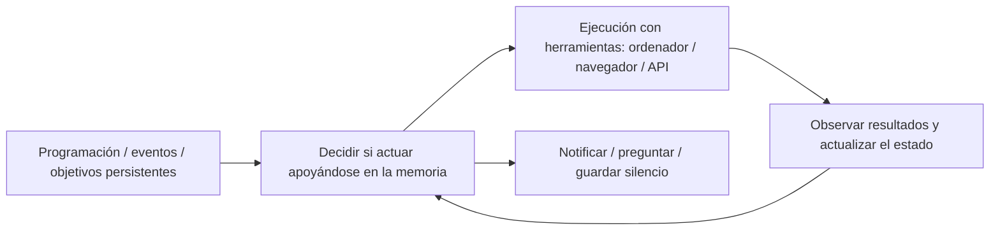

# awesome_bot

**Catálogo selecto de agentes proactivos, bots personales, extensiones de harness y artículos relacionados.**

Selección de agentes proactivos, bots personales, extensiones de harness, componentes de uso del ordenador y artículos de investigación, con la revisión canónica en chino, evidencia enlazada y clasificaciones reproducibles de mantenimiento en GitHub.

Los agentes que interesan aquí empiezan a trabajar de forma útil cuando el usuario no ha enviado ningún mensaje nuevo, guiándose por el tiempo, los cambios del entorno, objetivos persistentes o la memoria; interactúan con el entorno digital mediante herramientas y devuelven la información a la persona en el momento adecuado. La capacidad de callar, pausar o esperar una decisión humana también forma parte de la proactividad.

Esta lista recoge a la vez productos completos, extensiones que convierten agentes existentes en asistentes proactivos y los componentes de ejecución necesarios. **La ejecución programada, el juicio proactivo según contexto y el uso del ordenador son capacidades distintas que no se sustituyen entre sí.**

[Clasificación de proyectos](#categorías) · [Artículos](#artículos) · [Vistas de ordenación](docs/rankings.md) · [Rutas de extensión](docs/harness-guide.md) · [Proceso de búsqueda](docs/research.md) · [Contribuir](CONTRIBUTING.md)

Esta es la definición de trabajo que adopta el catálogo, no una afirmación de que todos los proyectos compartan una misma arquitectura. La primera versión es un punto de partida selectivo: se agradecen las omisiones que falten, pero no se declara exhaustivo el conjunto de proyectos.
