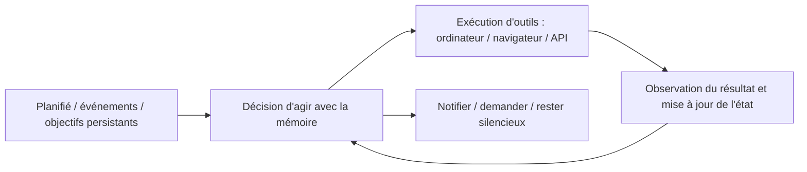

🌐 [English](../../README.md) · [简体中文](../zh/README.md) · [Español](../es/README.md) · [हिन्दी](../hi/README.md) · **Français**

# awesome_bot

**Catalogue sélectif d'agents proactifs, de bots personnels, d'extensions de harness, de composants de computer use et des articles de recherche associés (anglais par défaut, versions en chinois, espagnol, hindi et français).**

Agents proactifs, bots personnels, extensions de harness, composants de contrôle d'ordinateur et articles de recherche : sélection reliée aux preuves, avec des classements de maintenance GitHub reproductibles.

Les agents retenus ici se mettent à travailler utilement sans nouveau message de l'utilisateur, à partir de l'heure, d'un changement d'environnement, d'un objectif persistant ou de la mémoire ; ils interagissent avec l'environnement numérique au moyen d'outils et rendent compte aux personnes au moment opportun. Savoir rester silencieux, suspendre ou attendre une décision humaine fait aussi partie de la proactivité.

Ce catalogue réunit des produits complets, des extensions qui transforment un agent existant en assistant proactif et les briques d'exécution nécessaires. **Exécuter à heure fixe, juger une situation d'après le contexte et piloter un ordinateur sont trois capacités distinctes qui ne se substituent pas l'une à l'autre.**

[Catégories](#catégories) · [Publications](#publications) · [Vues de classement](docs/rankings.md) · [Feuille de route d'extension](docs/harness-guide.md) · [Processus de recherche](docs/research.md) · [Contribuer](CONTRIBUTING.md)



C'est la définition de travail adoptée par ce catalogue, non une affirmation sur l'architecture de tous les projets. Cette première version est un point de départ sélectif : les compléments sont bienvenus, aucune exhaustivité n'est revendiquée.


## Aller à une catégorie

[Assistants personnels always-on et runtimes légers](#assistants-personnels-always-on-et-runtimes-légers) · [Assistants d'espace de travail et de contexte](#assistants-despace-de-travail-et-de-contexte) · [Plugins proactifs et extensions d'ordonnancement](#plugins-proactifs-et-extensions-dordonnancement) · [Harness extensibles et socles d'exécution persistants](#harness-extensibles-et-socles-dexécution-persistants) · [Composants de contrôle ordinateur et navigateur](#composants-de-contrôle-ordinateur-et-navigateur) · [Implémentations de recherche et code d'évaluation](#implémentations-de-recherche-et-code-dévaluation) · [Projets historiques et migrations](#projets-historiques-et-migrations)

**Publications** · [Définitions, mécanismes et recherche fondamentale](#définitions-mécanismes-et-recherche-fondamentale) · [Systèmes d'agents personnels](#systèmes-dagents-personnels) · [Mémoire de long terme et besoins latents](#mémoire-de-long-terme-et-besoins-latents) · [Benchmarks de la proactivité](#benchmarks-de-la-proactivité) · [Contrôle de l'ordinateur et exécution personnalisée](#contrôle-de-lordinateur-et-exécution-personnalisée) · [Fonctionnement de longue durée et fiabilité](#fonctionnement-de-longue-durée-et-fiabilité)


## Instantané actuel

**44 projets ou dépôts de recherche et 17 articles** référencés. Relevé des métriques : **2026-11-26T09:37:27+00:00 (UTC)** ; vérification fonctionnelle manuelle : 2026-11-11.

Liste établie uniquement à partir de la documentation publique et des métadonnées GitHub ; aucun banc d'essai commun n'a encore été mené. Les catégories et les fonctions demandent une relecture humaine, les métriques sont rafraîchies par script.


## Aperçu des projets proactifs actifs

Sélection restreinte aux projets non archivés, à licence ouverte vérifiée et au mécanisme proactif documenté, classés par score de maintenance ; les composants adjacents, les licences à vérifier et les projets historiques n'entrent pas dans ce tableau.

| Projet | Mécanisme proactif | Étoiles | Commits 90 j | Dernier commit UTC | Score de maintenance |
| --- | --- | --- | --- | --- | --- |
| [OpenClaw](https://github.com/openclaw/openclaw) | Planifié / heartbeat / événements | 395,257 | 48,572 | 2026-11-26 | 100.0 |
| [Hermes Agent](https://github.com/NousResearch/hermes-agent) | Planifié / heartbeat de session | 266,213 | 50,744 | 2026-11-26 | 100.0 |
| [nanobot](https://github.com/HKUDS/nanobot) | Planifié / déclencheurs locaux | 50,355 | 1,220 | 2026-11-26 | 97.5 |
| [ZeroClaw](https://github.com/zeroclaw-labs/zeroclaw) | cron / webhook / MQTT | 33,628 | 1,073 | 2026-11-26 | 96.2 |
| [OpenMausBot](https://github.com/milind-soni/OpenMausBot) | schedules / webhooks / app events | 27,967 | 12,973 | 2026-11-26 | 95.6 |
| [NanoClaw](https://github.com/nanocoai/nanoclaw) | Planifié / script gates | 31,167 | 525 | 2026-11-24 | 95.5 |
| [OpenBot](https://github.com/CopilotKit/OpenBot) | Routines planifiées / déclenchement humain | 13,565 | 1,449 | 2026-11-26 | 93.0 |
| [Agent Zero](https://github.com/agent0ai/agent-zero) | scheduled operations | 19,995 | 438 | 2026-11-20 | 92.1 |
| [Rakazo](https://github.com/elie222/rakazo) | routines | 9,823 | 4,666 | 2026-11-26 | 91.9 |
| [Suparagent](https://github.com/Anil-matcha/suparagent) | scheduled / webhook / manual routines | 7,172 | 817 | 2026-11-26 | 90.8 |


## Catégories

`★référence utilisateur` signale un projet fourni par l'utilisateur. Les mêmes règles d'ordre s'appliquent dans chaque catégorie, les projets archivés passent automatiquement après. Les licences affichées reposent sur une vérification humaine et sur l'identification SPDX de GitHub ; une valeur inconnue n'est tenue ni pour zéro ni pour MIT par défaut.


### Assistants personnels always-on et runtimes légers


| Projet | Mécanisme / positionnement | Étoiles | Commits 90 j | Dernier commit UTC | Score de maintenance | Licence |
| --- | --- | --- | --- | --- | --- | --- |
| [OpenClaw](https://github.com/openclaw/openclaw) | Planifié / heartbeat / événements | 395,257 | 48,572 | 2026-11-26 | 100.0 | MIT |
| [Hermes Agent](https://github.com/NousResearch/hermes-agent) | Planifié / heartbeat de session | 266,213 | 50,744 | 2026-11-26 | 100.0 | MIT |
| [nanobot](https://github.com/HKUDS/nanobot) | Planifié / déclencheurs locaux | 50,355 | 1,220 | 2026-11-26 | 97.5 | MIT |
| [ZeroClaw](https://github.com/zeroclaw-labs/zeroclaw) | cron / webhook / MQTT | 33,628 | 1,073 | 2026-11-26 | 96.2 | Apache-2.0 |
| [OpenMausBot](https://github.com/milind-soni/OpenMausBot) | schedules / webhooks / app events | 27,967 | 12,973 | 2026-11-26 | 95.6 | Apache-2.0 (hors enterprise/) |
| [NanoClaw](https://github.com/nanocoai/nanoclaw) | Planifié / script gates | 31,167 | 525 | 2026-11-24 | 95.5 | MIT |
| [Rakazo](https://github.com/elie222/rakazo) · ★référence utilisateur | routines | 9,823 | 4,666 | 2026-11-26 | 91.9 | Apache-2.0 |
| [nanoMuse](https://github.com/nano-muse/nanoMuse) · ★référence utilisateur | Surveillance d'objectifs / routines | 3,720 | 2,767 | 2026-11-25 | 88.3 | GPL-3.0 |
| [Moltis](https://github.com/moltis-org/moltis) | cron | 2,988 | 49 | 2026-10-23 | 67.0 | MIT |
| [IronClaw](https://github.com/nearai/ironclaw) | Planifié / événements / heartbeat | 12,720 | 44 | 2026-09-10 | 64.9 | Apache-2.0 |
| [Comma](https://github.com/AFK-surf/Comma) | routines / event loops | 652 | 10 | 2026-11-17 | 58.7 | AGPL-3.0 |
| [PicoClaw](https://github.com/sipeed/picoclaw) | Planifié | 30,170 | 0 | 2026-08-19 | 44.2 | MIT |
| [Khoj](https://github.com/khoj-ai/khoj) | scheduled automations | 38,258 | 0 | 2026-08-02 | 43.5 | AGPL-3.0 |
| [rho](https://github.com/mikeyobrien/rho) | heartbeat | 378 | 0 | 2026-05-26 | 23.9 | MIT |
| [Mame](https://github.com/maikunari/mame) · Licence restrictive/à vérifier | cron / heartbeat | 0 | 0 | 2026-08-21 | 8.5 | MIT déclaré dans le README |


### Assistants d'espace de travail et de contexte


| Projet | Mécanisme / positionnement | Étoiles | Commits 90 j | Dernier commit UTC | Score de maintenance | Licence |
| --- | --- | --- | --- | --- | --- | --- |
| [OpenBot](https://github.com/CopilotKit/OpenBot) | Routines planifiées / déclenchement humain | 13,565 | 1,449 | 2026-11-26 | 93.0 | MIT |
| [Agent Zero](https://github.com/agent0ai/agent-zero) | scheduled operations | 19,995 | 438 | 2026-11-20 | 92.1 | MIT |
| [Suparagent](https://github.com/Anil-matcha/suparagent) | scheduled / webhook / manual routines | 7,172 | 817 | 2026-11-26 | 90.8 | Apache-2.0 |
| [PilotDeck](https://github.com/OpenBMB/PilotDeck) · ★référence utilisateur | Découverte de tâches always-on | 5,033 | 960 | 2026-11-25 | 89.4 | AGPL-3.0 |
| [OpenFuse](https://github.com/CopilotKit/openfuse) | Workers de tâches d'arrière-plan ; déclenchement autonome à vérifier | 6,590 | 147 | 2026-11-25 | 83.5 | MIT |
| [OpenDuet](https://github.com/CopilotKit/OpenDuet) | routines / suggestions d'arrière-plan | 2,158 | 92 | 2026-11-24 | 76.6 | MIT |
| [MineContext](https://github.com/volcengine/MineContext) | Observation du contexte / notifications proactives | 5,559 | 0 | 2026-05-07 | 32.6 | Apache-2.0 |


### Plugins proactifs et extensions d'ordonnancement


| Projet | Mécanisme / positionnement | Étoiles | Commits 90 j | Dernier commit UTC | Score de maintenance | Licence |
| --- | --- | --- | --- | --- | --- | --- |
| [DS Bot](https://github.com/Fei-Craft/DS-Bot) · ★référence utilisateur | Bots persistants / discussions de groupe ; réveil autonome à vérifier | 8,977 | 3,858 | 2026-11-22 | 90.5 | Apache-2.0 |
| [dsh-proactive](https://github.com/john-walks-slow/dsh-proactive) | once / interval / cron au niveau de l'hôte | 17 | 97 | 2026-10-26 | 53.5 | MIT |
| [murmur](https://github.com/t0dorakis/murmur) | cron / interval | 32 | 0 | 2026-02-10 | 13.2 | MIT |
| [Pulse](https://github.com/Hypostas/pulse) | Capteurs / déclenchement par urgence | 4 | 0 | 2026-07-06 | 10.7 | MIT |
| [Hermes Bot Mode](https://github.com/NousResearch/Hermes-Bot-Mode) · Archivé | Routines cron de l'hôte | 672 | 0 | 2026-08-17 | 30.7 | MIT |


### Harness extensibles et socles d'exécution persistants


| Projet | Mécanisme / positionnement | Étoiles | Commits 90 j | Dernier commit UTC | Score de maintenance | Licence |
| --- | --- | --- | --- | --- | --- | --- |
| [Pi](https://github.com/earendil-works/pi) | Ordonnancement externe requis / extensions | 123,973 | 2,364 | 2026-11-26 | 100.0 | MIT |
| [DeepSeek Harness](https://github.com/deepseek-ai/deepseek-harness) | Mécanisme proactif fourni par un plugin de l'hôte | 287,312 | 14,426 | 2026-11-22 | 98.9 | MIT |
| [Letta Code](https://github.com/letta-ai/letta-code) | remote environments / cron | 3,918 | 978 | 2026-11-26 | 88.7 | Apache-2.0 |


### Composants de contrôle ordinateur et navigateur


| Projet | Mécanisme / positionnement | Étoiles | Commits 90 j | Dernier commit UTC | Score de maintenance | Licence |
| --- | --- | --- | --- | --- | --- | --- |
| [Browser Use](https://github.com/browser-use/browser-use) | Tâches de navigateur à la demande | 122,112 | 954 | 2026-11-24 | 99.6 | MIT |
| [Windows-MCP](https://github.com/CursorTouch/Windows-MCP) · ★référence utilisateur | Appelé par l'hôte | 12,157 | 180 | 2026-11-26 | 86.9 | MIT |
| [Page Agent](https://github.com/alibaba/page-agent) | Appelé par la page ou par l'hôte | 29,767 | 40 | 2026-11-18 | 79.6 | MIT |
| [UI-TARS Desktop / Agent TARS](https://github.com/bytedance/UI-TARS-desktop) · Archivé | Tâches ordinateur / navigateur à la demande | 39,595 | 8 | 2026-10-09 | 63.8 | Apache-2.0 |


### Implémentations de recherche et code d'évaluation


| Projet | Mécanisme / positionnement | Étoiles | Commits 90 j | Dernier commit UTC | Score de maintenance | Licence |
| --- | --- | --- | --- | --- | --- | --- |
| [OSWorld](https://github.com/xlang-ai/OSWorld) | Évaluation de tâches sur ordinateur réel | 3,278 | 213 | 2026-11-23 | 82.4 | Apache-2.0 |
| [KnowU-Bench](https://github.com/ZJU-REAL/KnowU-Bench) | Évaluation mobile personnalisée interactive | 83 | 1 | 2026-11-13 | 41.0 | Apache-2.0 |
| [MemoProAgent](https://github.com/facebookresearch/Memo-Pro-Agent) · Licence restrictive/à vérifier | Évaluation d'interventions pilotées par la mémoire | 16 | 6 | 2026-10-22 | 37.7 | CC-BY-NC-4.0 |
| [π-Bench](https://github.com/Simplified-Reasoning/Pi-Bench) | Évaluation de la proactivité | 78 | 1 | 2026-10-13 | 34.4 | Apache-2.0 |
| [ProactiveAgent](https://github.com/thunlp/ProactiveAgent) | Observation d'événements / anticipation de tâches | 697 | 0 | 2026-05-12 | 25.5 | Apache-2.0 |
| [PASK](https://github.com/xzf-thu/Pask) | Détection de besoins latents / rester silencieux | 219 | 0 | 2026-04-17 | 20.8 | Apache-2.0 |
| [PARE](https://github.com/deepakn97/pare) | Assistants proactifs / évaluation par simulation d'utilisateurs | 50 | 0 | 2026-05-20 | 16.7 | MIT |
| [ProactiveBench (MLLM)](https://github.com/tdemin16/proactivebench) | Évaluation proactive multimodale | 32 | 0 | 2026-06-22 | 16.5 | MIT |
| [ContextAgent](https://github.com/openaiotlab/ContextAgent) · Licence restrictive/à vérifier | Contexte perceptif / prédiction de service | 59 | 0 | 2025-12-07 | 14.7 | À vérifier |


### Projets historiques et migrations


| Projet | Mécanisme / positionnement | Étoiles | Commits 90 j | Dernier commit UTC | Score de maintenance | Licence |
| --- | --- | --- | --- | --- | --- | --- |
| [LettaBot](https://github.com/letta-ai/lettabot) · Archivé | heartbeat / cron | 327 | 0 | 2026-05-03 | 22.6 | Apache-2.0 |


Descriptions complètes, limites et preuves dans [le détail des projets](docs/projects.md). Classements par étoiles, activité et dernier commit dans [les tables de classement](docs/rankings.md).

## Publications

Les articles sont regroupés par question traitée, puis classés par date de première soumission décroissante dans chaque groupe. L'année d'un article, les étoiles d'un projet et les capacités d'un système ne sont pas le même jugement et ne se combinent pas.


### Définitions, mécanismes et recherche fondamentale

| Première soumission | Article | Question traitée |
| --- | --- | --- |
| 2026-09-29 | [Foundations of Proactive Agents: Principles, Technical Layers, and Proactivity-Gym](https://arxiv.org/abs/2609.37267) | Discute les couches techniques et le coût pour l'utilisateur des agents proactifs, et introduit Proactivity-Gym. |
| 2025-05-20 | [ContextAgent: Context-Aware Proactive LLM Agents with Open-World Sensory Perceptions](https://arxiv.org/abs/2505.14668) | Exploite le contexte perceptif d'appareils portables et le profil historique pour prédire quand proposer un service et appeler des outils. |
| 2024-10-16 | [Proactive Agent: Shifting LLM Agents from Reactive Responses to Active Assistance](https://arxiv.org/abs/2410.12361) | Anticipe les tâches de l'utilisateur à partir des événements du bureau et étudie l'assistance proactive sans consigne explicite. |
| 2023-04-07 | [Generative Agents: Interactive Simulacra of Human Behavior](https://arxiv.org/abs/2304.03442) | Étudie la construction d'agents simulés capables de vivre et d'interagir de façon autonome grâce à la mémoire, la réflexion et la planification. |


### Systèmes d'agents personnels

| Première soumission | Article | Question traitée |
| --- | --- | --- |
| 2026-10-06 | [nanoMuse: An Open-Source Personal Agent for Every Device You Own](https://arxiv.org/abs/2610.08699) | Présente l'architecture logicielle, la mémoire et la conception d'interaction continue de l'agent personnel multi-appareils. |


### Mémoire de long terme et besoins latents

| Première soumission | Article | Question traitée |
| --- | --- | --- |
| 2026-10-15 | [MemoProAgent: Toward Memory-Driven Proactive Assistance](https://arxiv.org/abs/2610.22671) | Étudie la récupération, dans la mémoire personnelle de long terme, des éléments justifiant une intervention, la mémoire participant à la décision de parler ou non. |
| 2026-04-09 | [PASK: Toward Intent-Aware Proactive Agents with Long-Term Memory](https://arxiv.org/abs/2604.08000) | Combine mémoire de long terme, contexte temps réel et contraintes de latence pour détecter les besoins latents et choisir entre aider ou se taire. |


### Benchmarks de la proactivité

| Première soumission | Article | Question traitée |
| --- | --- | --- |
| 2026-05-14 | [π-Bench: Evaluating Proactive Personal Assistant Agents in Long-Horizon Workflows](https://arxiv.org/abs/2605.14678) | Évalue l'identification de besoins cachés et l'assistance proactive dans des flux de travail multi-tours de long terme. |
| 2026-04-09 | [KnowU-Bench: Towards Interactive, Proactive, and Personalized Mobile Agent Evaluation](https://arxiv.org/abs/2604.08455) | Évalue la façon dont un agent mobile recueille les préférences par l'interaction, intervient de sa propre initiative, demande l'accord ou reste silencieux. |
| 2026-04-01 | [Proactive Agent Research Environment: Simulating Active Users to Evaluate Proactive Assistants](https://arxiv.org/abs/2604.00842) | Étudie les assistants proactifs dans un environnement simulé d'applications à état et d'utilisateurs actifs. |
| 2026-03-19 | [ProactiveBench: Benchmarking Proactiveness in Multimodal Large Language Models](https://arxiv.org/abs/2603.19466) | Évalue la capacité des modèles multimodaux à obtenir spontanément des informations supplémentaires pour mener à bien une tâche visuelle. |
| 2026-03-09 | [PIRA-Bench: A Transition from Reactive GUI Agents to GUI-based Proactive Intent Recommendation Agents](https://arxiv.org/abs/2603.08013) | Recommande des intentions latentes à partir de captures successives de l'interface et du contexte de l'utilisateur. |
| 2026-02-04 | [ProAgentBench: Evaluating LLM Agents for Proactive Assistance with Real-World Data](https://arxiv.org/abs/2602.04482) | Évalue le moment et le contenu de l'assistance proactive à partir de journaux de flux de travail réels. |


### Contrôle de l'ordinateur et exécution personnalisée

| Première soumission | Article | Question traitée |
| --- | --- | --- |
| 2026-06-15 | [MyPCBench: A Benchmark for Personally Intelligent Computer-Use Agents](https://arxiv.org/abs/2606.16748) | Évalue des assistants capables d'agir sur l'ordinateur dans un environnement numérique doté de données personnelles et de sessions connectées. |
| 2024-04-11 | [OSWorld: Benchmarking Multimodal Agents for Open-Ended Tasks in Real Computer Environments](https://arxiv.org/abs/2404.07972) | Fournit un benchmark d'exécution de tâches ouvertes dans de véritables environnements informatiques. |


### Fonctionnement de longue durée et fiabilité

| Première soumission | Article | Question traitée |
| --- | --- | --- |
| 2026-05-13 | [Sleeper Channels and Provenance Gates: Persistent Prompt Injection in Always-on Autonomous AI Agents](https://arxiv.org/abs/2605.13471) | Analyse les chemins d'injection indirecte de prompts persistant à travers mémoire, compétences, ordonnancement et système de fichiers. |
| 2026-03-24 | [Mind Your HEARTBEAT! Claw Background Execution Inherently Enables Silent Memory Pollution](https://arxiv.org/abs/2603.23064) | Étudie la pollution silencieuse de la mémoire provoquée par un heartbeat d'arrière-plan exposé à du contenu non fiable. |


Versions, liens de code et périmètres d'application des articles dans [le détail des publications](docs/papers.md).

## Maintenance et contribution

- [Définitions, critères d'inclusion et taxonomie](docs/taxonomy.md)
- [Formule de classement et limites](docs/methodology.md)
- [Mots-clés de recherche, sources et couverture](docs/research.md)
- [Feuille de route d'extension sur un harness existant](docs/harness-guide.md)
- [Contribuer](CONTRIBUTING.md)

```sh
python scripts/refresh_metrics.py   # gh connecté ou GH_TOKEN requis
python scripts/build.py
python -m unittest discover -s tests
python scripts/build.py --check
```

GitHub Actions rafraîchit chaque jour les métriques et les classements des projets référencés. Les nouveaux projets, articles et classements fonctionnels passent par une vérification humaine avant fusion ; un rafraîchissement automatique des métriques ne relance pas l'audit des fonctions ni des licences.

## Remerciements et licences

La découverte est partie des index [Awesome Proactive Agents](https://github.com/LowEntropyAI/awesome-proactive-agent) et [Awesome Personal Agents](https://github.com/upgundecha/awesome-personal-agents) ; chaque entrée a été revérifiée sur le dépôt ou l'article d'origine.

Les textes originaux, les données organisées et les scripts de maintenance de ce dépôt sont sous [licence MIT](../../LICENSE). Les projets, articles, modèles et données liés suivent leurs propres licences.

[Le journal des modifications](../../record/) conserve le texte d'origine (en chinois) tel qu'il était au moment de la vérification, afin d'auditer la source et la formulation de chaque décision.
