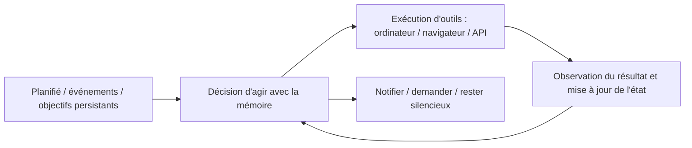

# awesome_bot

**Catalogue sélectif d'agents proactifs, de bots personnels, d'extensions de harness, de composants de computer use et des articles de recherche associés (anglais par défaut, versions en chinois, espagnol, hindi et français).**

Agents proactifs, bots personnels, extensions de harness, composants de contrôle d'ordinateur et articles de recherche : sélection reliée aux preuves, avec des classements de maintenance GitHub reproductibles.

Les agents retenus ici se mettent à travailler utilement sans nouveau message de l'utilisateur, à partir de l'heure, d'un changement d'environnement, d'un objectif persistant ou de la mémoire ; ils interagissent avec l'environnement numérique au moyen d'outils et rendent compte aux personnes au moment opportun. Savoir rester silencieux, suspendre ou attendre une décision humaine fait aussi partie de la proactivité.

Ce catalogue réunit des produits complets, des extensions qui transforment un agent existant en assistant proactif et les briques d'exécution nécessaires. **Exécuter à heure fixe, juger une situation d'après le contexte et piloter un ordinateur sont trois capacités distinctes qui ne se substituent pas l'une à l'autre.**

[Catégories](#catégories) · [Publications](#publications) · [Vues de classement](docs/rankings.md) · [Feuille de route d'extension](docs/harness-guide.md) · [Processus de recherche](docs/research.md) · [Contribuer](CONTRIBUTING.md)

C'est la définition de travail adoptée par ce catalogue, non une affirmation sur l'architecture de tous les projets. Cette première version est un point de départ sélectif : les compléments sont bienvenus, aucune exhaustivité n'est revendiquée.
