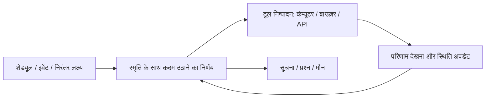

🌐 [English](../../README.md) · [简体中文](../zh/README.md) · [Español](../es/README.md) · **हिन्दी** · [Français](../fr/README.md)

# awesome_bot

**प्रैएक्टिव Agent, पर्सनल Bot, Harness एक्सटेंशन और संबंधित शोध-पत्रों की चुनिंदा निर्देशिका (अंग्रेज़ी डिफ़ॉल्ट, साथ में चीनी, स्पेनिश, हिन्दी और फ़्रेंच संस्करण)।**

क्यूरेटेड प्रैएक्टिव एजेंट, व्यक्तिगत बॉट, harness एक्सटेंशन, computer-use घटक और शोध-पत्र — प्रमाण-लिंक वाले विवरण और दोबारा चलायी जा सकने वाली GitHub मेंटेनेंस रैंकिंग के साथ।

यहाँ वे Agent शामिल हैं जो उपयोगकर्ता की कोई नई संदेश न आने पर भी समय, वातावरण परिवर्तन, निरंतर लक्ष्य या स्मृति के आधार पर उपयोगी काम स्वयं आरंभ करते हैं, टूल्स से डिजिटल वातावरण से जुड़ते हैं और उचित समय पर मनुष्य को सूचना देते हैं। चुप रह पाना, रुकना या मनुष्य के निर्णय का इंतज़ार करना भी प्रैएक्टिवनेस का हिस्सा है।

यह सूची पूर्ण उत्पाद, मौजूदा Agent को प्रैएक्टिव असिस्टेंट बनाने वाले एक्सटेंशन और आवश्यक निष्पादन घटक तीनों एकत्र करती है। **शेड्यूल निष्पादन, कंटेक्स्ट-आधारित प्रैएक्टिव निर्णय और कंप्यूटर संचालन अलग-अलग क्षमताएँ हैं — एक-दूसरे का स्थान नहीं लेतीं।**

[श्रेणियाँ](#श्रेणियाँ) · [शोध-पत्र](#शोध-पत्र) · [रैंकिंग दृश्य](docs/rankings.md) · [एक्सटेंशन रास्ता](docs/harness-guide.md) · [खोज प्रक्रिया](docs/research.md) · [योगदान](CONTRIBUTING.md)



यह काम-परिभाषा इस निर्देशिका द्वारा अपनाई गई है, यह सभी परियोजनाओं की एक जैसी वास्तविक आर्किटेक्चर का दावा नहीं है। पहला संस्करण एक चुनी हुई शुरुआत है; छूटी चीज़ों की पूर्ति स्वागतयोग्य है, यह सभी परियोजनाओं की खोज-पूर्णता नहीं दाखल करता।


## श्रेणी पर जाएँ

[सदैव-चालू व्यक्तिगत असिस्टेंट और हल्के रनटाइम](#सदैव-चालू-व्यक्तिगत-असिस्टेंट-और-हल्के-रनटाइम) · [वर्कस्पेस और कंटेक्स्ट असिस्टेंट](#वर्कस्पेस-और-कंटेक्स्ट-असिस्टेंट) · [प्रैएक्टिव प्लगइन और शेड्यूलिंग एक्सटेंशन](#प्रैएक्टिव-प्लगइन-और-शेड्यूलिंग-एक्सटेंशन) · [एक्सटेंसिबल Harness और निरंतर संचालन आधार](#एक्सटेंसिबल-harness-और-निरंतर-संचालन-आधार) · [कंप्यूटर और ब्राउज़र कंट्रोल घटक](#कंप्यूटर-और-ब्राउज़र-कंट्रोल-घटक) · [रिसर्च इम्प्लीमेंटेशन और इवैल्यूएशन कोड](#रिसर्च-इम्प्लीमेंटेशन-और-इवैल्यूएशन-कोड) · [ऐतिहासिक और माइग्रेशन प्रोजेक्ट](#ऐतिहासिक-और-माइग्रेशन-प्रोजेक्ट)

**शोध-पत्र** · [परिभाषाएँ, तंत्र और बुनियादी शोध](#परिभाषाएँ-तंत्र-और-बुनियादी-शोध) · [पर्सनल Agent सिस्टम](#पर्सनल-agent-सिस्टम) · [दीर्घकालिक स्मृति और संभावित आवश्यकताएँ](#दीर्घकालिक-स्मृति-और-संभावित-आवश्यकताएँ) · [प्रैएक्टिवनेस इवैल्यूएशन बेंचमार्क](#प्रैएक्टिवनेस-इवैल्यूएशन-बेंचमार्क) · [कंप्यूटर संचालन और पर्सनलाइज़्ड एक्ज़ीक्यूशन](#कंप्यूटर-संचालन-और-पर्सनलाइज़्ड-एक्ज़ीक्यूशन) · [लंबे संचालन और रिलायबिलिटी शोध](#लंबे-संचालन-और-रिलायबिलिटी-शोध)


## वर्तमान स्नैपशॉट

संग्रह में **44 प्रोजेक्ट / रिसर्च कोडबेस और 17 शोध-पत्र**। मीट्रिक संग्रह: **2026-11-28T08:56:37+00:00 (UTC)**; फ़ंक्शन का मानवीय सत्यापन: 2026-11-11।

केवल सार्वजनिक डॉक्यूमेंटेशन और GitHub मेटाडेटा पर आधारित; अब तक कोई एकीकृत रन-मूल्यांकन नहीं किया गया है। श्रेणियाँ और फ़ंक्शन मानवीय पुनःसमीक्षा माँगते हैं, मीट्रिक स्क्रिप्ट से अपडेट होते हैं।


## सक्रिय प्रैएक्टिव प्रोजेक्ट की झलक

यहाँ केवल वे प्रोजेक्ट आते हैं जिनका खुला लाइसेंस सत्यापित है, प्रैएक्टिव तंत्र डॉक्यूमेंटेड है और वे संग्रहित नहीं हैं; क्रम मेंटेनेंस स्कोर के अनुसार। संलग्न घटक, असत्यापित लाइसेंस और ऐतिहासिक प्रोजेक्ट इस तालिका में नहीं आते।

| प्रोजेक्ट | प्रैएक्टिव तंत्र | Stars | 90-दिन कमिट | नवीनतम कमिट UTC | मेंटेनेंस स्कोर |
| --- | --- | --- | --- | --- | --- |
| [OpenClaw](https://github.com/openclaw/openclaw) | शेड्यूल / heartbeat / इवेंट | 395,366 | 48,600 | 2026-11-28 | 100.0 |
| [Hermes Agent](https://github.com/NousResearch/hermes-agent) | शेड्यूल / सेशन heartbeat | 266,650 | 50,934 | 2026-11-28 | 100.0 |
| [nanobot](https://github.com/HKUDS/nanobot) | शेड्यूल / लोकल ट्रिगर | 50,409 | 1,212 | 2026-11-27 | 97.4 |
| [ZeroClaw](https://github.com/zeroclaw-labs/zeroclaw) | cron / webhook / MQTT | 33,642 | 1,045 | 2026-11-26 | 95.8 |
| [NanoClaw](https://github.com/nanocoai/nanoclaw) | शेड्यूल / script gates | 31,173 | 505 | 2026-11-27 | 95.7 |
| [OpenMausBot](https://github.com/milind-soni/OpenMausBot) | schedules / webhooks / app events | 28,652 | 13,341 | 2026-11-27 | 95.5 |
| [OpenBot](https://github.com/CopilotKit/OpenBot) | शेड्यूल routines / मैन्युअल आरंभ | 13,846 | 1,536 | 2026-11-28 | 93.1 |
| [Rakazo](https://github.com/elie222/rakazo) | routines | 10,052 | 4,731 | 2026-11-28 | 92.0 |
| [Agent Zero](https://github.com/agent0ai/agent-zero) | scheduled operations | 20,018 | 438 | 2026-11-20 | 91.6 |
| [Suparagent](https://github.com/Anil-matcha/suparagent) | scheduled / webhook / manual routines | 7,198 | 898 | 2026-11-28 | 90.8 |


## श्रेणियाँ

`★बीज` उपयोगकर्ता द्वारा दिए गए संदर्भ प्रोजेक्टों को दर्शाता है। सभी श्रेणियों में वही क्रम-नियम लागू होते हैं; संग्रहित प्रोजेक्ट स्वतः पीछे हो जाते हैं। लाइसेंस प्रदर्शन मानवीय सत्यापन और GitHub SPDX पहचान पर आधारित है; अज्ञात को शून्य या डिफ़ॉल्ट MIT नहीं माना जाता।


### सदैव-चालू व्यक्तिगत असिस्टेंट और हल्के रनटाइम


| प्रोजेक्ट | तंत्र / स्थिति | Stars | 90-दिन कमिट | नवीनतम कमिट UTC | मेंटेनेंस स्कोर | लाइसेंस |
| --- | --- | --- | --- | --- | --- | --- |
| [OpenClaw](https://github.com/openclaw/openclaw) | शेड्यूल / heartbeat / इवेंट | 395,366 | 48,600 | 2026-11-28 | 100.0 | MIT |
| [Hermes Agent](https://github.com/NousResearch/hermes-agent) | शेड्यूल / सेशन heartbeat | 266,650 | 50,934 | 2026-11-28 | 100.0 | MIT |
| [nanobot](https://github.com/HKUDS/nanobot) | शेड्यूल / लोकल ट्रिगर | 50,409 | 1,212 | 2026-11-27 | 97.4 | MIT |
| [ZeroClaw](https://github.com/zeroclaw-labs/zeroclaw) | cron / webhook / MQTT | 33,642 | 1,045 | 2026-11-26 | 95.8 | Apache-2.0 |
| [NanoClaw](https://github.com/nanocoai/nanoclaw) | शेड्यूल / script gates | 31,173 | 505 | 2026-11-27 | 95.7 | MIT |
| [OpenMausBot](https://github.com/milind-soni/OpenMausBot) | schedules / webhooks / app events | 28,652 | 13,341 | 2026-11-27 | 95.5 | Apache-2.0 (enterprise/ छोड़कर) |
| [Rakazo](https://github.com/elie222/rakazo) · ★बीज | routines | 10,052 | 4,731 | 2026-11-28 | 92.0 | Apache-2.0 |
| [nanoMuse](https://github.com/nano-muse/nanoMuse) · ★बीज | लक्ष्य निरीक्षण / routines | 3,765 | 2,804 | 2026-11-27 | 88.4 | GPL-3.0 |
| [Moltis](https://github.com/moltis-org/moltis) | cron | 2,989 | 49 | 2026-10-23 | 66.7 | MIT |
| [IronClaw](https://github.com/nearai/ironclaw) | शेड्यूल / इवेंट / heartbeat | 12,721 | 32 | 2026-09-10 | 63.0 | Apache-2.0 |
| [Comma](https://github.com/AFK-surf/Comma) | routines / event loops | 726 | 12 | 2026-11-27 | 62.2 | AGPL-3.0 |
| [PicoClaw](https://github.com/sipeed/picoclaw) | शेड्यूल | 30,177 | 0 | 2026-08-19 | 44.0 | MIT |
| [Khoj](https://github.com/khoj-ai/khoj) | scheduled automations | 38,273 | 0 | 2026-08-02 | 43.4 | AGPL-3.0 |
| [rho](https://github.com/mikeyobrien/rho) | heartbeat | 378 | 0 | 2026-05-26 | 23.8 | MIT |
| [Mame](https://github.com/maikunari/mame) · लाइसेंस सीमा/असत्यापित | cron / heartbeat | 0 | 0 | 2026-08-21 | 8.3 | README में MIT घोषित |


### वर्कस्पेस और कंटेक्स्ट असिस्टेंट


| प्रोजेक्ट | तंत्र / स्थिति | Stars | 90-दिन कमिट | नवीनतम कमिट UTC | मेंटेनेंस स्कोर | लाइसेंस |
| --- | --- | --- | --- | --- | --- | --- |
| [OpenBot](https://github.com/CopilotKit/OpenBot) | शेड्यूल routines / मैन्युअल आरंभ | 13,846 | 1,536 | 2026-11-28 | 93.1 | MIT |
| [Agent Zero](https://github.com/agent0ai/agent-zero) | scheduled operations | 20,018 | 438 | 2026-11-20 | 91.6 | MIT |
| [Suparagent](https://github.com/Anil-matcha/suparagent) | scheduled / webhook / manual routines | 7,198 | 898 | 2026-11-28 | 90.8 | Apache-2.0 |
| [PilotDeck](https://github.com/OpenBMB/PilotDeck) · ★बीज | always-on टास्क खोज | 5,040 | 960 | 2026-11-25 | 88.8 | AGPL-3.0 |
| [OpenFuse](https://github.com/CopilotKit/openfuse) | बैकग्राउंड टास्क worker; स्वतः ट्रिगर असत्यापित | 6,606 | 147 | 2026-11-25 | 83.0 | MIT |
| [OpenDuet](https://github.com/CopilotKit/OpenDuet) | routines / बैकग्राउंड सुझाव | 2,165 | 92 | 2026-11-24 | 76.1 | MIT |
| [MineContext](https://github.com/volcengine/MineContext) | कंटेक्स्ट अवलोकन / प्रैएक्टिव पुश | 5,559 | 0 | 2026-05-07 | 32.5 | Apache-2.0 |


### प्रैएक्टिव प्लगइन और शेड्यूलिंग एक्सटेंशन


| प्रोजेक्ट | तंत्र / स्थिति | Stars | 90-दिन कमिट | नवीनतम कमिट UTC | मेंटेनेंस स्कोर | लाइसेंस |
| --- | --- | --- | --- | --- | --- | --- |
| [DS Bot](https://github.com/Fei-Craft/DS-Bot) · ★बीज | निरंतर Bot / ग्रुप चैट; स्वतः जागरण असत्यापित | 9,189 | 5,260 | 2026-11-28 | 91.7 | Apache-2.0 |
| [dsh-proactive](https://github.com/john-walks-slow/dsh-proactive) | होस्ट-स्तरीय once / interval / cron | 18 | 95 | 2026-10-26 | 53.2 | MIT |
| [murmur](https://github.com/t0dorakis/murmur) | cron / interval | 32 | 0 | 2026-02-10 | 13.1 | MIT |
| [Pulse](https://github.com/Hypostas/pulse) | सेंसिंग / आपातता-ट्रिगर | 4 | 0 | 2026-07-06 | 10.6 | MIT |
| [Hermes Bot Mode](https://github.com/NousResearch/Hermes-Bot-Mode) · संग्रहित | होस्ट cron routines | 672 | 0 | 2026-08-17 | 30.6 | MIT |


### एक्सटेंसिबल Harness और निरंतर संचालन आधार


| प्रोजेक्ट | तंत्र / स्थिति | Stars | 90-दिन कमिट | नवीनतम कमिट UTC | मेंटेनेंस स्कोर | लाइसेंस |
| --- | --- | --- | --- | --- | --- | --- |
| [Pi](https://github.com/earendil-works/pi) | ऊपरी शेड्यूलर / एक्सटेंशन चाहिए | 124,411 | 2,855 | 2026-11-27 | 99.9 | MIT |
| [DeepSeek Harness](https://github.com/deepseek-ai/deepseek-harness) | प्रैएक्टिव तंत्र होस्ट प्लगइन से आना चाहिए | 288,189 | 14,280 | 2026-11-22 | 98.4 | MIT |
| [Letta Code](https://github.com/letta-ai/letta-code) | remote environments / cron | 3,927 | 970 | 2026-11-28 | 88.7 | Apache-2.0 |


### कंप्यूटर और ब्राउज़र कंट्रोल घटक


| प्रोजेक्ट | तंत्र / स्थिति | Stars | 90-दिन कमिट | नवीनतम कमिट UTC | मेंटेनेंस स्कोर | लाइसेंस |
| --- | --- | --- | --- | --- | --- | --- |
| [Browser Use](https://github.com/browser-use/browser-use) | मांग पर ब्राउज़र कार्य | 122,261 | 947 | 2026-11-27 | 99.7 | MIT |
| [Windows-MCP](https://github.com/CursorTouch/Windows-MCP) · ★बीज | होस्ट द्वारा कॉल | 12,238 | 185 | 2026-11-28 | 87.1 | MIT |
| [Page Agent](https://github.com/alibaba/page-agent) | वेबपेज या होस्ट द्वारा कॉल | 29,775 | 40 | 2026-11-18 | 79.1 | MIT |
| [UI-TARS Desktop / Agent TARS](https://github.com/bytedance/UI-TARS-desktop) · संग्रहित | मांग पर कंप्यूटर / ब्राउज़र कार्य | 39,597 | 8 | 2026-10-09 | 63.5 | Apache-2.0 |


### रिसर्च इम्प्लीमेंटेशन और इवैल्यूएशन कोड


| प्रोजेक्ट | तंत्र / स्थिति | Stars | 90-दिन कमिट | नवीनतम कमिट UTC | मेंटेनेंस स्कोर | लाइसेंस |
| --- | --- | --- | --- | --- | --- | --- |
| [OSWorld](https://github.com/xlang-ai/OSWorld) | असली कंप्यूटर-टास्क इवैल्यूएशन | 3,279 | 212 | 2026-11-23 | 81.9 | Apache-2.0 |
| [KnowU-Bench](https://github.com/ZJU-REAL/KnowU-Bench) | इंटरैक्टिव पर्सनलाइज़्ड मोबाइल इवैल्यूएशन | 83 | 1 | 2026-11-13 | 40.6 | Apache-2.0 |
| [MemoProAgent](https://github.com/facebookresearch/Memo-Pro-Agent) · लाइसेंस सीमा/असत्यापित | स्मृति-संचालित हस्तक्षेप इवैल्यूएशन | 16 | 6 | 2026-10-22 | 37.3 | CC-BY-NC-4.0 |
| [π-Bench](https://github.com/Simplified-Reasoning/Pi-Bench) | प्रैएक्टिवनेस इवैल्यूएशन | 78 | 1 | 2026-10-13 | 34.1 | Apache-2.0 |
| [ProactiveAgent](https://github.com/thunlp/ProactiveAgent) | इवेंट अवलोकन / टास्क पूर्वानुमान | 698 | 0 | 2026-05-12 | 25.5 | Apache-2.0 |
| [PASK](https://github.com/xzf-thu/Pask) | संभावित आवश्यकता पहचान / चुप रहना | 219 | 0 | 2026-04-17 | 20.8 | Apache-2.0 |
| [PARE](https://github.com/deepakn97/pare) | प्रैएक्टिव असिस्टेंट / उपयोगकर्ता सिमुलेशन इवैल्यूएशन | 50 | 0 | 2026-05-20 | 16.6 | MIT |
| [ProactiveBench (MLLM)](https://github.com/tdemin16/proactivebench) | मल्टीमोडल प्रैएक्टिवनेस इवैल्यूएशन | 32 | 0 | 2026-06-22 | 16.4 | MIT |
| [ContextAgent](https://github.com/openaiotlab/ContextAgent) · लाइसेंस सीमा/असत्यापित | सेंसिंग कंटेक्स्ट / सेवा पूर्वानुमान | 59 | 0 | 2025-12-07 | 14.7 | असत्यापित |


### ऐतिहासिक और माइग्रेशन प्रोजेक्ट


| प्रोजेक्ट | तंत्र / स्थिति | Stars | 90-दिन कमिट | नवीनतम कमिट UTC | मेंटेनेंस स्कोर | लाइसेंस |
| --- | --- | --- | --- | --- | --- | --- |
| [LettaBot](https://github.com/letta-ai/lettabot) · संग्रहित | heartbeat / cron | 327 | 0 | 2026-05-03 | 22.6 | Apache-2.0 |


पूरे विवरण, सीमाएँ और प्रमाण [प्रोजेक्ट विवरण तालिका](docs/projects.md) में हैं। star, गतिविधि और नवीनतम कमिट के अलग-अलग दृश्य [रैंकिंग तालिका](docs/rankings.md) में देखें।

## शोध-पत्र

शोध-पत्र प्रश्न के अनुसार वर्गीकृत हैं; एक ही श्रेणी में प्रथम सबमिशन तिथि के अवरोही क्रम में। पेपर का वर्ष, प्रोजेक्ट के star और सिस्टम की क्षमता अलग-अलग मूल्यांकन हैं — इन्हें मिलाकर नहीं गिना जाता।


### परिभाषाएँ, तंत्र और बुनियादी शोध

| प्रथम सबमिशन | शोध-पत्र | केंद्रीय प्रश्न |
| --- | --- | --- |
| 2026-09-29 | [Foundations of Proactive Agents: Principles, Technical Layers, and Proactivity-Gym](https://arxiv.org/abs/2609.37267) | प्रैएक्टिव Agent के तकनीकी लेयर और उपयोगकर्ता-लागत पर चर्चा, तथा Proactivity-Gym का प्रस्ताव। |
| 2025-05-20 | [ContextAgent: Context-Aware Proactive LLM Agents with Open-World Sensory Perceptions](https://arxiv.org/abs/2505.14668) | वियरेबल डिवाइस की सेंसिंग कंटेक्स्ट और ऐतिहासिक प्रोफ़ाइल से अनुमान लगाता है कि सेवा कब देनी है और कौन-से टूल बुलाए जाने हैं। |
| 2024-10-16 | [Proactive Agent: Shifting LLM Agents from Reactive Responses to Active Assistance](https://arxiv.org/abs/2410.12361) | डेस्कटॉप इवेंट्स से उपयोगकर्ता के कार्य का पूर्वानुमान और बिना स्पष्ट निर्देश के प्रैएक्टिव सहायता का शोध। |
| 2023-04-07 | [Generative Agents: Interactive Simulacra of Human Behavior](https://arxiv.org/abs/2304.03442) | स्मृति, प्रतिबिम्बन और योजना से स्वतः जीवन-जीने वाले सिमुलेटेड Agent बनाने का शोध। |


### पर्सनल Agent सिस्टम

| प्रथम सबमिशन | शोध-पत्र | केंद्रीय प्रश्न |
| --- | --- | --- |
| 2026-10-06 | [nanoMuse: An Open-Source Personal Agent for Every Device You Own](https://arxiv.org/abs/2610.08699) | क्रॉस-डिवाइस पर्सनल Agent का सॉफ़्टवेयर आर्किटेक्चर, स्मृति और निरंतर इंटरैक्शन डिज़ाइन प्रस्तुत करता है। |


### दीर्घकालिक स्मृति और संभावित आवश्यकताएँ

| प्रथम सबमिशन | शोध-पत्र | केंद्रीय प्रश्न |
| --- | --- | --- |
| 2026-10-15 | [MemoProAgent: Toward Memory-Driven Proactive Assistance](https://arxiv.org/abs/2610.22671) | दीर्घकालिक व्यक्तिगत स्मृति से हस्तक्षेप-प्रमाण खोज का शोध, ताकि बोलने के निर्णय में स्मृति भाग ले। |
| 2026-04-09 | [PASK: Toward Intent-Aware Proactive Agents with Long-Term Memory](https://arxiv.org/abs/2604.08000) | दीर्घकालिक स्मृति, लाइव कंटेक्स्ट और latency बाधाओं को जोड़कर संभावित आवश्यकता पहचानती है, फिर सहायता या मौन चुनती है। |


### प्रैएक्टिवनेस इवैल्यूएशन बेंचमार्क

| प्रथम सबमिशन | शोध-पत्र | केंद्रीय प्रश्न |
| --- | --- | --- |
| 2026-05-14 | [π-Bench: Evaluating Proactive Personal Assistant Agents in Long-Horizon Workflows](https://arxiv.org/abs/2605.14678) | बहु-चरणीय दीर्घकालिक वर्कफ़्लो में छिपी आवश्यकता पहचान और प्रैएक्टिव सहायता का आकलन। |
| 2026-04-09 | [KnowU-Bench: Towards Interactive, Proactive, and Personalized Mobile Agent Evaluation](https://arxiv.org/abs/2604.08455) | मोबाइल Agent द्वारा इंटरैक्शन से पसंद हासिल करना, प्रैएक्टिव हस्तक्षेप, अनुमति माँगना या मौन रहना मापता है। |
| 2026-04-01 | [Proactive Agent Research Environment: Simulating Active Users to Evaluate Proactive Assistants](https://arxiv.org/abs/2604.00842) | stateful ऐप और सक्रिय उपयोगकर्ताओं के सिमुलेशन वातावरण से प्रैएक्टिव असिस्टेंट का शोध। |
| 2026-03-19 | [ProactiveBench: Benchmarking Proactiveness in Multimodal Large Language Models](https://arxiv.org/abs/2603.19466) | दृश्य कार्य पूरा करने के लिए मल्टीमोडल मॉडलों द्वारा अतिरिक्त सूचना का प्रैएक्टिव संग्रह मापता है। |
| 2026-03-09 | [PIRA-Bench: A Transition from Reactive GUI Agents to GUI-based Proactive Intent Recommendation Agents](https://arxiv.org/abs/2603.08013) | निरंतर GUI स्क्रीनशॉट और उपयोगकर्ता कंटेक्स्ट से संभावित इरादे का सुझाव। |
| 2026-02-04 | [ProAgentBench: Evaluating LLM Agents for Proactive Assistance with Real-World Data](https://arxiv.org/abs/2602.04482) | असली वर्कफ़्लो लॉग से प्रैएक्टिव सहायता के समय और सामग्री का आकलन। |


### कंप्यूटर संचालन और पर्सनलाइज़्ड एक्ज़ीक्यूशन

| प्रथम सबमिशन | शोध-पत्र | केंद्रीय प्रश्न |
| --- | --- | --- |
| 2026-06-15 | [MyPCBench: A Benchmark for Personally Intelligent Computer-Use Agents](https://arxiv.org/abs/2606.16748) | व्यक्तिगत डेटा और लॉगिन स्थिति वाले डिजिटल वातावरण में कंप्यूटर-संचालन असिस्टेंट का आकलन। |
| 2024-04-11 | [OSWorld: Benchmarking Multimodal Agents for Open-Ended Tasks in Real Computer Environments](https://arxiv.org/abs/2404.07972) | असली कंप्यूटर वातावरण में खुले-समापन कार्यों के निष्पादन का benchmark देता है। |


### लंबे संचालन और रिलायबिलिटी शोध

| प्रथम सबमिशन | शोध-पत्र | केंद्रीय प्रश्न |
| --- | --- | --- |
| 2026-05-13 | [Sleeper Channels and Provenance Gates: Persistent Prompt Injection in Always-on Autonomous AI Agents](https://arxiv.org/abs/2605.13471) | स्मृति, स्किल, शेड्यूलिंग और फ़ाइल सिस्टम में टिके रहने वाली अप्रत्यक्ष prompt injection पथों का विश्लेषण। |
| 2026-03-24 | [Mind Your HEARTBEAT! Claw Background Execution Inherently Enables Silent Memory Pollution](https://arxiv.org/abs/2603.23064) | बैकग्राउंड heartbeat के अविश्वसनीय सामग्री से संपर्क के बाद होने वाली मौन स्मृति-दूषण का शोध। |


संस्करण, कोड-संबंध और प्रयोज्य सीमा [शोध-पत्र विवरण तालिका](docs/papers.md) में हैं।

## मेंटेनेंस और योगदान

- [परिभाषाएँ, समावेश मानदंड और श्रेणियाँ](docs/taxonomy.md)
- [रैंकिंग सूत्र और सीमाएँ](docs/methodology.md)
- [खोज कीवर्ड, स्रोत और कवरेज](docs/research.md)
- [मौजूदा Harness पर एक्सटेंशन का रास्ता](docs/harness-guide.md)
- [योगदान](CONTRIBUTING.md)

```sh
python scripts/refresh_metrics.py   # gh लॉगिन या GH_TOKEN चाहिए
python scripts/build.py
python -m unittest discover -s tests
python scripts/build.py --check
```

GitHub Actions रोज़ संग्रहीत प्रोजेक्टों के मीट्रिक और रैंकिंग अपडेट करता है। नए प्रोजेक्ट, पेपर और फ़ंक्शन वर्गीकरण मानवीय सत्यापन के बाद मर्ज होते हैं; स्वचालित मीट्रिक अपडेट का अर्थ फ़ंक्शन या लाइसेंस का पुनः-ऑडिट नहीं है।

## आभार और लाइसेंस

खोज के प्रवेश बिंदु के रूप में [Awesome Proactive Agents](https://github.com/LowEntropyAI/awesome-proactive-agent) और [Awesome Personal Agents](https://github.com/upgundecha/awesome-personal-agents) से संदर्भ लिया गया; हर प्रविष्टि की पुष्टि मूल रिपॉज़िटरी और पेपर पर की गई।

इस रिपॉज़िटरी के मूल लेख, व्यवस्थित डेटा और मेंटेनेंस स्क्रिप्ट [MIT](../../LICENSE) के अंतर्गत हैं। लिंक किए गए प्रोजेक्ट, पेपर, मॉडल और डेटा अपने-अपने लाइसेंस का पालन करते हैं।

[परिवर्तन रिकॉर्ड](../../record/) सत्यापन के समय का मूल पाठ (चीनी में) सुरक्षित रखता है, ताकि हर निर्णय के स्रोत और उस समय के शब्द-चयन का ऑडिट हो सके।
