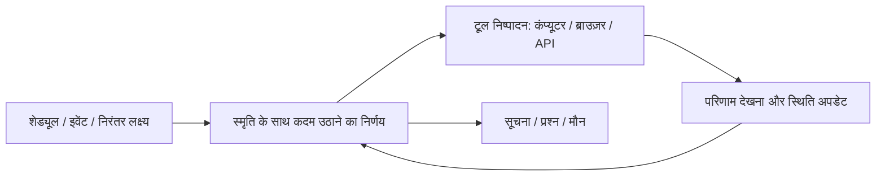

# awesome_bot

**प्रैएक्टिव Agent, पर्सनल Bot, Harness एक्सटेंशन और संबंधित शोध-पत्रों की चुनिंदा निर्देशिका (अंग्रेज़ी डिफ़ॉल्ट, साथ में चीनी, स्पेनिश, हिन्दी और फ़्रेंच संस्करण)।**

क्यूरेटेड प्रैएक्टिव एजेंट, व्यक्तिगत बॉट, harness एक्सटेंशन, computer-use घटक और शोध-पत्र — प्रमाण-लिंक वाले विवरण और दोबारा चलायी जा सकने वाली GitHub मेंटेनेंस रैंकिंग के साथ।

यहाँ वे Agent शामिल हैं जो उपयोगकर्ता की कोई नई संदेश न आने पर भी समय, वातावरण परिवर्तन, निरंतर लक्ष्य या स्मृति के आधार पर उपयोगी काम स्वयं आरंभ करते हैं, टूल्स से डिजिटल वातावरण से जुड़ते हैं और उचित समय पर मनुष्य को सूचना देते हैं। चुप रह पाना, रुकना या मनुष्य के निर्णय का इंतज़ार करना भी प्रैएक्टिवनेस का हिस्सा है।

यह सूची पूर्ण उत्पाद, मौजूदा Agent को प्रैएक्टिव असिस्टेंट बनाने वाले एक्सटेंशन और आवश्यक निष्पादन घटक तीनों एकत्र करती है। **शेड्यूल निष्पादन, कंटेक्स्ट-आधारित प्रैएक्टिव निर्णय और कंप्यूटर संचालन अलग-अलग क्षमताएँ हैं — एक-दूसरे का स्थान नहीं लेतीं।**

[श्रेणियाँ](#श्रेणियाँ) · [शोध-पत्र](#शोध-पत्र) · [रैंकिंग दृश्य](docs/rankings.md) · [एक्सटेंशन रास्ता](docs/harness-guide.md) · [खोज प्रक्रिया](docs/research.md) · [योगदान](CONTRIBUTING.md)

यह काम-परिभाषा इस निर्देशिका द्वारा अपनाई गई है, यह सभी परियोजनाओं की एक जैसी वास्तविक आर्किटेक्चर का दावा नहीं है। पहला संस्करण एक चुनी हुई शुरुआत है; छूटी चीज़ों की पूर्ति स्वागतयोग्य है, यह सभी परियोजनाओं की खोज-पूर्णता नहीं दाखल करता।
